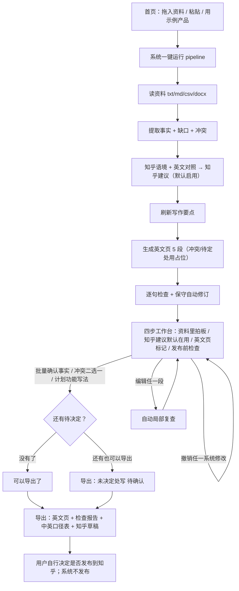

# Zhihu Bridge 后续开发计划（V1.4 体验重构版）

## 从句子转译原型升级为基于知乎知识增强的出海内容本地化与跨文化适配工具：复杂留给系统，用户只做真正的判断

- **项目仓库**：<https://github.com/NorthingPalinode/zhihu-bridge>
- **计划版本**：V1.4。在 V1.3 的基础上，按“复杂留给系统、用户体验至高无上”的原则重构交互、文案与数据模型。
- **规划基线**：
  - V1.3 计划全文；
  - 本地 `app/` 源码实查（包括旧版 `connected.ts` / `ui/*` 的交互盘点）；
  - V1.3 原型 `.ui-preview/direction-d.html` 的逐项交互审查；
  - Gemini（`gemini-4-neon`）作为方案、文案与交互顾问出具的独立审查报告，见 `.ui-preview/_review/gemini-ux-review.md`；
  - 官方评分权重：AI 场景价值 40%、创新度 25%、完成度 25%、产品体验与设计感 10%。
- **视觉与交互基准**：`.ui-preview/direction-d3.html`（V1.4 原型：沿用 V1.3 Direction D 的四步工作台与视觉，按体验宪章只做减法；已在 1440 和 390 两种宽度下实际操作验证，**待用户确认**）。
- **首个垂直场景**：中国（优先大湾区）智能硬件品牌，面向美国市场准备英文新品发布或众筹内容。
- **日程**：本版不含日程安排。

> **V1.4 修订说明（相对 V1.3）**
>
> 1. **新增体验宪章（§0.4），优先级最高。**
>    - 8 条原则逐条写成可自动验收的规则（§8.4）。
>    - 硬指标：演示项目从首页到「可以导出」，用户只做 **3 次真正的判断**，总点击 ≤ 6；每个写操作都可撤销；不强制跳页；界面不出现版本号、内部编号和接口名。
> 2. **保留四步工作台与 Direction D 的视觉，只做减法（§3、§4）。**
>    - 保留：带状态的四步流程条、两栏面板、知乎 ⟷ 英文桥接卡、卖点与依据联动高亮、检查页的原句定位、分层依据和修改对照。
>    - 系统一口气跑完：提取事实 → 知乎洞察 → 写作要点 → 生成 → 检查 → 安全修订。四步变成“可看、可改，但不必逐步推进”：流程条上每一步都用人话显示状态。
>    - 用户真正要做的 3 件事集中在第 1 步「产品资料」的决定区。同一个决定卡片也出现在正文占位弹层和第 4 步检查页，在哪里做都一样。
>    - 取消：新建项目表单、逐行三段按钮、营销开关、采纳复选框、手动复检按钮、过期黄条、额度面板、KPI 大卡、问题筛选、常驻 Trace、内部编号与版本号。
>    - 过程记录：中途试过“单页文档”方案（d2），用户评估后认为视觉质感、流程感和细节交互都变弱了，因此回到 D 为底。
> 3. **事实决定减负，但可信底线不变（§3.3、§5）。**
>    - 资料明确支持的事实，一次批量确认。
>    - 冲突在正文里就地二选一：系统给推荐但**不代选**。
>    - 没有依据的声称自动排除，不需要用户驳回。
>    - `marketing_allowed` 不再由用户逐条开关，改为派生字段 `draft_usable` / `publish_ready`；另设可选的 `internal_only`。
>    - 模型依然不得写入 `user_decision`。
> 4. **知乎建议默认启用（opt-out）。** Brief 随事实与建议变化自动刷新，前台不再单独展示，改称「写作要点」。
> 5. **审校改为「自动检查 + 保守自动修订 + 人只处理定不了的事」（§3.6）。**
>    - 只删除或弱化无依据声称、按写作要点替换术语、补单位与边界说明，这几类修订自动应用；全部留痕，并可逐条撤销。正文里以绿色虚线标出，点开可以看原句、原因和依据。
>    - 撤销高风险修订须先选预设理由。
>    - 编辑后自动局部复查（防抖），删除「仅复检受影响模块」按钮。
>    - 用户只看到三种状态：需要你决定 / 系统已处理 / 你保留了原句。后端保留严重度与细分状态，用于报告。
> 6. **新增统一操作日志 `ActionLog` 与撤销机制（§5）。** 撤销入口有三个：Toast 撤销、Ctrl/Cmd+Z、列表内「撤销」。
> 7. **导出永不被阻断。** 未决定项写成 `[待确认]` 并列入检查报告；检查报告和中英口径表自动附带；知乎草稿自检由系统完成，只剩「转载授权」一项需人工确认，仍然不自动发布。
> 8. **知乎额度、获取方式与 Trace 由系统托管。** 只在影响结果时就近说明；「生成记录与数据来源」移到页脚。
> 9. **资料格式增加 `.docx`**（纯文本抽取，成本低）。PDF 和图片仍不支持；读不出来时提供就地「粘贴文字」入口，不阻断流程。
> 10. **统一术语与颜色语义（§4.2）。** 琥珀 = 需要你，绿 = 系统已处理或已完成，红 = 风险或已拦下，石板灰 = 演示或说明。AI 推断改用灰色虚线，不再与警示色混用。
> 11. **PR 路线随之调整（§10）。** 撤销日志、决定队列、自动复查、保守自动修订在 PR-02 骨架阶段就内建，避免后期返工。PR-08 新增体验验收自动化。

---

# 0. 执行摘要

## 0.1 产品方向决策

Zhihu Bridge 不再以“把一段中文翻译成英文”为核心产品任务，而是升级为（V1.4 起，以“复杂留给系统”为最高体验原则）：

> **基于知乎知识增强的出海内容本地化与跨文化适配工作台：帮助中国智能硬件品牌拆解中文工程语境与跨地域出海经验，结合企业产品资料转化为面向美国市场的新品内容，并在发布前完成事实核验、宣传声称审查与双语知识回流。**

它不是把知乎当作装饰性搜索框，而是通过**“中文知乎行业语境与出海经验 × 英文目标市场表达对照”**产出用户可见、可操作、直接驱动内容策略的**跨文化认知洞察卡**，再确保每一条海外卖点都忠于企业事实、可审校、可交付。

第一阶段聚焦一个足够具体的业务场景：

- **用户**：中国（优先验证大湾区）智能硬件创业团队创始人／产品负责人、跨境品牌内容运营、海外众筹项目负责人。
- **市场与语言**：美国英语市场（English - US）。
- **核心任务**：将分散的产品资料转化为一套可编辑的英文新品发布／众筹页面内容，并完成发布前事实与声称审校。
- **核心交付**：
  1. 结构化产品事实档案（Product Fact Sheet）
  2. 跨文化认知洞察卡与内容策略 Brief
  3. 五类英文内容资产（主标题与宣传语、核心卖点、详细介绍、技术参数、FAQ）
  4. 可追溯的发布前审校报告
  5. 可人工审核的「知乎知识回流包」（双语术语口径表 + 国内技术拆解／问答草稿）

**核心差异化**：不在于“翻译得更像母语”，而在于**把知乎社区知识、企业产品事实与目标市场表达连接成一条可追溯的链路**。先懂语境与认知差，再守住产品事实边界，最后交付业务团队敢直接上线的内容资产。

## 0.2 核心工作流（一键运行 + 3 次判断）

1. **放进资料**：在首页拖入或粘贴产品资料（`.txt` / `.md` / `.csv` / `.docx`），或点「用示例产品试一下」。不填表单，产品名、渠道、受众、语气由系统从资料中推断。
2. **系统一口气跑完**：读资料 → 找出产品事实（含缺口与冲突）→ 查知乎上的行业说法与英文对照 → 刷新写作要点 → 写英文页（5 段）→ 逐句检查 → 自动应用保守修订。进度页逐步显示结果摘要，完成后自动进入工作台。
3. **用户只处理「需要你决定」**（集中在第 1 步「产品资料」的决定区，顶栏状态胶囊随时可以直达）：
   - 一次确认系统读出的、资料写得明确的事实；
   - 冲突事实二选一（系统推荐，不代选）；
   - 计划功能等需要商业判断的写法；
   - 用户自己新写进去的风险说法。
4. **随时核查与撤销**：正文里「系统改过」的地方点开即可看到原句、原因与分层依据，并可恢复；所有操作都能撤销。
5. **导出**：一次拿走英文页 Markdown、检查报告、中英口径表与知乎技术拆解草稿（不自动发布）。

## 0.3 研发原则

- **先业务结果，后技术展示**：首屏就是写好的英文页和要你决定的事；生成记录、检索日志与额度默认不出现。
- **事实优先于文案**：没有企业资料支持的产品能力、参数、认证、续航与性能承诺，严禁模型补造。
- **来源权责严格分层**（命名全文统一，见 §5.2）：
  - **企业产品资料（`company_doc`，界面叫「你的资料」）**：唯一的产品事实与参数依据。
  - **知乎社区语境（`zhihu_community`，界面叫「知乎讨论」）**：核心知识增强层，不替代参数证明或官方法规。
  - **英文参考对照（`global_reference`，界面叫「英文同类产品」）**：来自 `global_search` 或用户提供。
  - **官方规则提示（`official_rule`）**：附来源 URL 与获取时间，无法确认时标「需要你核实」。
  - **AI 推断（`ai_inference`）**：没有外部证据时必须显式标注「AI 推断 · 待验证」。
- **AI 辅助、人类拍板**：AI 判定与用户决定分字段存储；系统可以推荐，不可以代选；自动修订只能让内容更保守；不宣称法律合规；不自动发布。
- **先单市场、单语言、单场景，先打通贯穿骨架**：先用演示数据打通全链路，再逐层替换为真实能力，任何时刻都保有一条可演示的完整路径。

## 0.4 体验宪章（最高优先级，所有 PR 的验收前提）

> 用户原话：“交互还是太复杂了，复杂应该留给我们系统，不要留给用户，用户体验至高无上。”

| # | 原则 | 落到产品上的硬规则 | 自动验收（§8.4） |
| :-: | :--- | :--- | :--- |
| 1 | 系统能判断的，不留给用户 | 市场、语言固定为静态文本；渠道、受众、语气由资料推断，以可修改的芯片呈现。资料明确支持的事实批量确认，不逐条点选。安全修订自动应用。冲突给推荐并说明理由 | 主路径真正判断 ≤ 3 次 |
| 2 | 此刻没用的，就不出现 | 界面不出现版本号、内部编号（F-/I-/R-/W-）、接口名、Brief、Trace、stale。额度与获取方式只在影响结果时就近说明。事实列表和资料列表默认折叠 | 文案词典扫描 |
| 3 | 能替人做的，就直接做 | 一键全链路；知乎建议默认启用；改动后自动局部复查；检查报告、口径表、知乎草稿自检自动生成；解析失败时给就地补救入口 | 编辑后 ≤ 2 s 出复查结果 |
| 4 | 同一件事，处处一样 | 一个概念一个名字（§4.2 术语表）。颜色语义固定。同一个决定在正文弹层和右侧队列里用同一组件、同一组选项。每段正文的工具位置固定（编辑 / ⋯） | 组件快照测试 |
| 5 | 按下去有回应，再按能收回 | 每个写操作都有即时反馈（≤ 100 ms 的视觉变化，长任务显示「检查中…」）。每个写操作都可撤销（Toast、Ctrl/Cmd+Z、列表内撤销），撤销后状态与版本完全复原 | 每类写操作「执行 → 撤销 → 状态相等」 |
| 6 | 不打断人手上的事 | 不强制跳页或切换视图。决定在当前位置完成（弹层或侧栏）。复查在后台进行，不推开布局。编辑中不被后台结果覆盖。不使用阻断式模态确认 | 写操作后 URL 与滚动容器不变 |
| 7 | 常用的好做，会丢东西的难误碰 | 推荐选项排第一并获得默认焦点。恢复高风险原句须先选理由。「重新生成」收进「⋯」并可撤销。手改过的内容不会被静默覆盖 | 默认焦点从不落在风险动作上 |
| 8 | 界面自己说明自己 | 状态用完整人话（「还需你决定 3 件」「系统改过，点开可撤销」）。图例只有两条。每个占位符都写明在等什么 | 5 秒首页理解测试（人工） |

---

# 1. 当前项目基线与问题诊断

> 以下基线已结合本地 `app/` 源码实查。G0 仍需确定代码事实来源（§1.4）、记录 commit SHA、运行现有测试并实测接口额度。

## 1.1 已有能力（实查确认，优先复用）

| 当前模块／文件 | 当前实查职责 | V1.4 复用方向 |
| :--- | :--- | :--- |
| `app/server/bridge/adapters/zhihu.py`（838 行） | 知乎开放能力适配器，按 6 类额度资源计费（`zhihu_search`、`global_search`、`question_discovery`、`zhida_openai`、`knowledge`、`creator`）。方法包括 `search`、`question_recommendations`、`question_answers`（共用 question_discovery 额度）、`global_search`、`zhida_ask`、`knowledge_bases/items/search/upload`、`creator_*`（仅限个人 Access Secret）。内置 SQLite 日预算、24h 缓存、在途请求合并、错误分类（disabled / budget / auth / rate_limit / timeout 等）与噪音过滤 | 项目级「知乎认知洞察」与「英文参考对照」的底层适配器，不重写 |
| `app/server/bridge/config.py` | 预算上限等配置；公网默认日上限：`zhihu_search` 6、`global_search` 6、`question_discovery` 6、`zhida` 10、`knowledge` 10 | 洞察服务的额度预算依据（§1.6） |
| `app/server/bridge/api/zhihu_sessions.py`（49 行） | 浏览器短时个人知乎凭证会话（8 小时 TTL，cookie 仅存随机 handle，最多 256 个会话） | 复用为个人密钥接入机制；演示时的实时调用优先走个人会话额度 |
| `app/server/bridge/api/app.py`（655 行） | 现有路由：`/api/zhihu/*`、`/api/runs`（SSE 流式）、`/api/questions/draft`、`/api/compliance/rules`、`/api/cases`、`/api/health` | 新增项目级路由，保留旧路由服务 `legacy.html` |
| `app/server/bridge/pipeline/runs.py`（921 行） | 单句转译运行主流程（分析、检索、生成、守门） | 抽取可复用的编排与 SSE 机制，用于项目级多阶段运行 |
| `app/server/bridge/pipeline/questions.py`（196 行） | 知乎回流闭环：误解句／用户粘贴 → 查知乎已有讨论 → 多体裁可编辑草稿 → 复制并直达知乎对应板块，系统不发布 | 升级为「知乎知识回流包」生成流程 |
| `app/server/bridge/core/guard.py`（153 行） | 风险、保真与禁词规则检查 | 扩展为四维审校引擎；PR-02 骨架阶段直接用其规则匹配做最薄审校 |
| `app/server/bridge/core/store.py` / `replay.py` | SQLite 持久化与缓存／回放 | 扩展项目级存储；回放用于演示与降级 |
| `app/server/bridge/adapters/llm_fake.py` | 确定性的假模型实现 | PR-02 贯穿骨架的生成后端（界面标注“开发占位 · 非真实运行”） |
| `app/server/bridge/contracts.py` + `app/contracts/*.schema.json` | 后端 Pydantic 契约与导出的 JSON Schema | 扩充项目级契约，并同步导出 JSON Schema |
| `app/server/bridge/adapters/prompts.py` | 模型提示词管理 | 按任务拆分为事实提取、洞察、Brief、内容生成、审校与回流提示词 |
| `app/server/bridge/pipeline/tests.py` | 模拟读者复述评估 | 保留为可选可读性评估，显式标注“模拟读者评估”，不作真实用户数据 |
| `app/fixtures/cases/case_b_hardware.json` | 智能穿戴众筹单句案例（“堆料 / 极限压榨功耗 / 底层协议调试”、决策与证据 ID） | 扩展为 PulseRing X1 项目级演示资料包的种子（明确标注虚构产品） |
| `app/web/src/connected.ts`（2371 行）+ `index.html`（1178 行） | 当前真正对外运行的旧版界面与真实接入逻辑 | 原样移至 `legacy.html` 保留，不再追加功能 |
| `app/web/src/App.tsx` / `ui/*` | V5 三栏单句转译的 React 组件（未被挂载） | 不作为新工作台基础；`lib/{sse,offline,api}.ts` 中的通用逻辑可评估复用 |
| `app/web/src/zhihuCredentials.ts` / `zhihuTools.ts` | 前端知乎凭证配置与工具接入 | 复用至新版「来源连接」抽屉 |
| `app/web/public/offline/bundle.json` + `lib/offline.ts` | 静态离线演示模式 | 新工作台同样提供离线演示项目快照 |
| `app/web/e2e/{smoke,prototype,degrade}.mjs` | 基于 playwright-core 的烟测，选择器指向旧页面（`#startBtn`、`#copyFinal` 等） | 切换入口后改为指向 `legacy.html`；新工作台另写烟测 |

## 1.2 当前产品形态的主要问题

1. **输入形态像单句翻译器**：首页是粘贴短文本开始转译，缺少产品项目与多份资料上下文。
2. **案例跨度分散**：仙侠字幕、智能硬件、草本茶并列，无法在 5 秒内传达明确的目标用户。
3. **界面暴露过多内部步骤**：证据、认知桥、转译策略、守门、模拟测试、交付、答主视角、Trace 同屏出现，信息噪音高。
4. **知乎知识价值不够显性**：用户难以看清知乎讨论如何转化为认知洞察并实际改变海外文案，且缺少可落地的回流产物。
5. **项目级数据模型缺失**：单次运行结构无法承载多份资料、事实版本、来源冲突、五类内容资产与审校过期联动。
6. **（V1.4 新增）V1.3 方案把系统状态机摊给了用户**：V1.3 原型中，用户需要逐行点「确认」再拨「可用于营销」，逐张勾「采纳进 Brief」，手动按「仅复检受影响模块」，在 4 个标签之间被来回跳转，还要面对 6 种审校状态，以及事实集 v4、Brief v2、`curated_demo`、额度表等工程概念。走完一次主路径需要 30 次以上点击，且处置后无法撤销。用户反馈：“复杂应该留给系统，不要留给用户。”

## 1.3 前端双入口现状与切换代价

经实查 `app/web/index.html`、`vite.config.ts` 与 `src/`：

- `vite` 以 `app/web/index.html` 为入口。该文件含大量内联样式与旧原型脚本，末尾动态 `import('./src/connected.ts')` 挂载真实接入逻辑，**未挂载 `src/main.tsx`**。
- `src/main.tsx` → `App.tsx` → `ui/*` 是一套**同样面向旧单句转译产品**的 React 组件（V5 三栏），当前未被使用。
- 现有 e2e 烟测选择器全部指向旧页面。
- `vite.config.ts` 通过 `ZB_TEST_BUNDLE` 别名替换 `public/offline/bundle.json`，离线演示依赖此机制。

**结论**：“切换到 `main.tsx`”实际等于**新建工作台前端**，无法复用现有 React 界面组件。

**架构决策（PR-00 输出 ADR-001，PR-01 落地）**：

- 使用 Vite 多页面输入：`index.html` → 新 React 工作台入口（`src/main.tsx` 重写为挂载新 App）；旧页面原样移至 `legacy.html`（仍挂载 `connected.ts`）。
- 现有 e2e 烟测改为指向 `/legacy.html` 并保持通过，作为旧能力回归保护。
- 旧 `App.tsx` / `ui/*` 在新工作台可用后归档或删除，不与新代码并行演进。
- 绝不在 `legacy.html` 内联脚本上追加新功能。

## 1.4 代码事实来源

- 本地 `D:\agent_project\Zhihu Bridge\app` 不是 git 仓库；GitHub 克隆位于 `app/var/github-zhihu-bridge`（最新提交 `e5351af`）。
- 两者存在差异：本地多出 `docs/`、`SHA256SUMS.txt`、`web/src/assets/delivery-hardware-bg.png`，且 `README_zh.md`、`.gitignore`、`server/tests/test_api.py`、`web/e2e/prototype.mjs` 内容不同。
- **G0 必须先确定唯一事实来源**：建议以 GitHub 仓库为准，把本地差异合入后再开分支；之后所有 PR 在 git 工作区中进行，才能记录 commit SHA。

## 1.5 设计资产现状（V1.4）

| 文件 | 现状 | 处理 |
| :--- | :--- | :--- |
| `PRODUCT.md` | **已按 V1.4 更新**：体验宪章、四步工作台减负版的信息架构、3 次判断的主路径、术语表 | 随原型确认一并定稿 |
| `.ui-preview/direction-d3.html` | **V1.4 原型**：以 D 为底只做减法。一键运行 → 四步工作台 → 3 个决定 → 撤销 → 自动复查 → 导出。已在 1440 和 390 两种宽度下实际操作验证 | 等待用户确认；确认后成为视觉与交互的唯一基准 |
| `.ui-preview/direction-d2.html` | 单页文档方案 | **用户已否决**：视觉变平、流程感消失、细节交互变弱；仅作记录 |
| `.ui-preview/direction-d.html` | V1.3 四标签原型（视觉方向 D：证据链工程台） | d3 的底版；布局与视觉全部沿用 |
| `.ui-preview/direction-a/b/c.html` | 早期三标签方向稿 | 仅作历史参考 |
| `DESIGN.md` | V5 三栏单句转译规范 | PR-00 在用户确认 d3 后重写为 V1.4 版（体验宪章、术语表、颜色语义、组件与焦点规则） |
| `.ui-preview/_review/gemini-ux-review.md` | Gemini 方案、文案与交互顾问的审查报告 | 已吸收进 V1.4（见 §15）；未采纳项见 §15 附注 |

**要求**：用户在浏览器中确认 `direction-d3.html`，PR-00 据此更新 `DESIGN.md`，之后 PR-02 才开始写新前端 UI。

## 1.6 知乎接口约束（必须在 G0 实测确认）

**额度**：公网默认日上限 `zhihu_search` 6、`global_search` 6、`question_discovery` 6（`question_answers` 共用）、`zhida` 10、`knowledge` 10；`creator` 仅个人 Access Secret 可用。若一次洞察对 3 个概念各调一次知乎搜索、问题发现与全网搜索，即需 9 次，超过单项公网日上限。

**英文对照能力未验证**：`global_search` 只透传 `Query` / `Count` / `SearchDB` / `Filter`，无语言参数；现有缓存样本几乎全部来自 zhihu.com，仅 1 条来自 wuxiaworld；Day0 报告结论为“按需低频调用或仅离线取样”。

**G0 实测要求**：

1. 用至少 5 个英文查询（如 `smart ring kickstarter battery life`、`smart ring waterproof 5 ATM review`）调用 `global_search`，记录返回条数、来源域名分布、是否含英文正文。
2. 测 `zhihu_search` + `question_answers` 能否拿到“堆料 / 极限压榨功耗 / 底层协议调试 / Kickstarter 硬件众筹经验”的可用回答摘录。
3. 核实 `knowledge_upload` 上传内容的可见范围（是否仅本人可见），决定可选增强是否开放（§3.7）。
4. 根据结果确定英文对照侧的主路径与降级路径，写入 ADR / 能力核查表。

---

# 2. 产品定位、用户与边界

## 2.1 产品定位

- **产品类别**：基于知乎知识增强的出海内容本地化与跨文化适配工作台。
- **首个垂直场景**：中国（优先面向粤港澳大湾区）智能硬件品牌面向美国市场的英文新品发布／众筹内容准备。
- **一句话介绍**：
  > 连接企业产品资料与知乎社区知识，帮助智能硬件出海团队理解跨文化认知差异、生成可追溯的英文新品内容，并在发布前完成事实审校与双语知识沉淀。
- **项目命名**：暂保留 `Zhihu Bridge`，契合“知乎知识 × 海外市场认知桥梁”的定位。

## 2.2 首个目标用户与痛点

### 主要用户

- 中国（大湾区）智能硬件创业团队创始人或产品负责人。
- 跨境硬件品牌的海外市场／内容运营人员。
- 准备在 Kickstarter / Indiegogo / 海外独立站发布新品的项目负责人。

### 核心痛点

- 中文工程资料和卖点很多（如“高密度堆料主板”“极限压榨功耗”），但直译后海外消费者看不懂或不信任。
- 不清楚同类硬件在中文技术社区和海外众筹受众之间存在哪些认知差与高频质疑。
- 营销初稿容易夸大性能（“全天续航”“行业领先”“医疗级”），与规格表、测试报告不一致，上线前缺少系统化核查。
- 海外内容准备完成后，术语口径与技术解释散落各处，无法复用到客服、代理商沟通与国内技术公关。

## 2.3 核心 Jobs-to-be-Done

当我要把一款智能硬件新品推向美国众筹或独立站时，我希望导入现有产品资料，借助知乎行业语境与出海经验看清哪些概念海外会误解，快速生成一套忠于产品事实的英文发布页，在上线前逐项排雷，并顺手沉淀出可复用的双语术语与国内技术解读草稿。

## 2.4 MVP 范围

| 维度 | V1.4 MVP 决策 |
| :--- | :--- |
| 产品品类 | 智能硬件／消费电子（首案为智能指环） |
| 目标市场与语言 | 美国 · 美式英语（English - US） |
| 首个发布场景 | 海外众筹（Kickstarter）／新品发布页面 |
| 输入 | **无表单**：拖入或上传 `.txt` / `.md` / `.csv` / `.docx`（纯文本抽取），或粘贴文本；渠道、受众、语气由系统推断。**MVP 不解析 `.xlsx` / PDF / 图片**，读不出时就地提供「粘贴文字」入口，不阻断流程 |
| 核心中间资产 | 产品事实（Product Fact Sheet）、知乎建议（ZhihuInsight，默认启用）、写作要点（ContentBrief，自动刷新，不单独展示） |
| 核心内容输出 | 五类英文资产：主标题与宣传语、核心卖点、详细介绍、技术参数、FAQ |
| 审校与交付输出 | 自动四维检查与保守修订、检查报告、英文 Markdown 导出、中英口径表、知乎技术拆解草稿 |
| 知识来源体系 | 企业资料（事实依据）+ 知乎社区（核心语境与出海经验）+ 英文参考（`global_search` 或用户提供）+ 官方来源（规则提示）+ AI 推断（显式标注） |
| 用户控制边界 | 用户只做系统定不了的判断：一次确认事实、冲突二选一、计划功能写法、保留风险原句（须选理由）；一切系统修改可见可撤销；严禁静默编造、自动选定冲突或自动发布 |

## 2.5 MVP 暂不做

- 全行业通用出海平台、多国家多语言并行生成。
- 自动报价、订单、库存、物流、CRM 或多租户复杂权限审批。
- 自动发布到 Kickstarter、Indiegogo、Amazon、独立站或知乎（回流仅生成草稿与导出）。
- 法律合规认证或宣称“保证通过平台／监管审核”。
- 真实海外消费者大规模问卷调研（严禁把 AI 推断或模拟测试包装为海外调研结论）。
- `.xlsx` / PDF 自动解析与图片视觉识别（`.docx` 已在 V1.4 纳入 MVP）。
- 把多 Agent 自主协作框架或“答主共创中心”作为 MVP 主卖点。

---

# 3. 核心业务流程与产品体验

## 3.1 主流程总览



## 3.2 阶段 A：开始（无表单）

- 首页只有一个主动作：**拖入或选择资料**，其次是「粘贴文字」和「用示例产品试一下」。删除 V1.3 的新建项目弹窗。
- **系统推断**：产品名称与品类（从资料标题、规格表抽取）、发布渠道（Kickstarter 或独立站）、目标受众、品牌语气。这些在工作台顶部以芯片呈现，标注「系统根据资料判断的，不对可以改」。
  - 修改芯片后，系统自动重写受影响的段落，可撤销。
  - 市场与语言（美国 · 美式英语）是 MVP 固定值，以静态文本呈现，不提供下拉框。
- **运行进度页**：5 步，每步完成后写出一句结果摘要，例如「8 条事实；机身重量两份资料写得不一样，留给你定」。完成后自动进入工作台第 1 步，不需要用户再点。用户离开页面，运行也会继续；回来时停在结果页。

## 3.3 阶段 B：资料与产品事实（系统判断 + 一次确认）

- **支持格式**：`.txt` / `.md` / `.csv` / `.docx`（纯文本抽取）/ 粘贴文本。
  - PDF 和图片不解析，显示「读不出文字，没有用作依据 · 粘贴其中文字」，不阻断流程，也不计入依据。
  - 严禁对解析失败的资料显示「已读取」。
- **AI 判定 `evidence_status`（仅系统写）**：`supported` / `needs_confirmation` / `conflicting` / `unsupported`，与 V1.3 相同。
- **用户决定 `user_decision`（仅用户写）**：`pending` / `confirmed` / `edited` / `rejected`。新增 `decided_via`（`batch` / `single` / `inline`）记录决定是怎么做出的。
- **系统按判定结果分组呈现，用户只处理真正需要人的部分**：

| AI 判定 | 系统默认处理 | 用户需要做什么 | 界面位置 |
| :--- | :--- | :--- | :--- |
| `supported` | 起草时先用（标记为待确认） | **一次**「都对，确认这 N 条」；不对的逐条「不对？」就地改写或「不要用这条」 | 第 1 步「资料写得明确的 N 条」 |
| `conflicting` | 正文写占位「重量等你决定」；给出**推荐**及理由（如“规格表是更新的 EVT3 样机，并写明了测量指围”） | 二选一或自己填写；**系统绝不代选** | 第 1 步决定区、正文占位弹层、第 4 步检查页，三处是同一组件 |
| `needs_confirmation`（如路线图功能） | 正文写占位；给出照实写法作为推荐 | 选写法（照实写 / 先不提） | 同上 |
| `unsupported`（如 FDA 认证） | **自动排除，不进入任何内容**，无需用户驳回 | 无；如确有证据，「补充资料」后系统自动重判 | 第 1 步「系统不会使用的」与第 4 步「系统已替你处理」 |

- **派生字段，不再逐条手动开关**：
  - `draft_usable` = `evidence_status=supported` 且未被驳回，或用户已确认 / 已修改。
  - `publish_ready` = `user_decision ∈ {confirmed, edited}`。
  - 可选的 `internal_only` 由用户标记，默认 false；标记后不进入任何对外内容。
- **「可以导出了」的条件**：正文引用的所有事实都已 `publish_ready`，且没有未决定的冲突或计划功能写法。不满足时**仍可导出**，但相应位置写成 `[待确认]` 并列入检查报告。
- **事实集版本 `fact_set_version`**：照常递增，用于推算检查状态，**界面不显示**。一次批量确认只加 1。

## 3.4 阶段 C：知乎认知洞察（系统默认启用，价值显性可见）

本阶段仍是 Zhihu Bridge 区别于普通翻译器的核心机制，但**不再要求用户逐条采纳**。

### “Bridge 桥梁”双侧逻辑（同 V1.3）

1. **中文知乎侧**（`zhihu_search` / `question_discovery` / `question_answers` / `zhida_openai`）：拆解工程黑话的真实含义与争议，聚合出海一线经验；只回答“中文语境是什么、出海者踩过什么坑”，不代表美国消费者。
2. **英文对照侧（三级来源）**：`global_search` 英文结果（经 G0 验证）→ 用户提供的英文参考 → `ai_inference`（显示「AI 推断 · 待验证」）。

### 额度由系统托管（用户看不到额度面板）

- 每个概念合并为一条查询，优先命中 24 小时缓存；同一项目默认复用已有证据。
- 额度不足、鉴权失败或超时：系统自动改用缓存或示例数据继续，**在受影响的依据旁就近标注**（如「示例数据，未实时检索」），并在「生成记录与数据来源」里记录原因。严禁把缓存或示例数据显示为实时结果。
- 个人知乎凭证只在用户主动「连接知乎账号」时使用，入口在生成记录抽屉中，不在主界面。

### 用户可见输出：第 2 步「知乎认知洞察」（沿用 D 的桥接卡）

- 每张卡片包括：知乎讨论 ⟷ 英文对照（带来源层标签与获取方式）、直译可能引起的误解（标为 AI 分析，非调研结论）、系统怎么写、直译与本地化对比。
- 卡片底部是「在用 / 没用」开关，并说明「用在：核心卖点第 1 条 · 详细介绍」。**默认全部在用**，不需要勾选采纳。
- 关掉一张后，正文对应句子立即改回普通写法，相关段落自动复查，可撤销。
- 第 3 步左栏固定「洞察带来的改变」对比卡（工程笔记原句 / 普通直译 / Zhihu Bridge），点任意卖点会高亮它用到的事实和知乎建议。这是 **Demo 中“知乎洞察如何具体改变英文文案”的主证据**。

### 写作要点（`ContentBrief`，原 Brief）

由 `draft_usable` 的事实和已启用的知乎建议自动生成，并在二者变化时自动刷新。内容包括受众关注点、术语中英映射、必答质疑（直通 FAQ）和禁用表达。**前台不单独展示**：其中的术语映射进入中英口径表，禁用表达进入检查规则。数据上仍记录 `fact_set_version` 与启用的建议版本。

### 知乎数据合规（同 V1.3）

- 不以点赞或收藏充当可信度。
- 只通过适配器、个人授权会话或用户提供的内容获取数据。
- 不编造问题、答主或链接。

## 3.5 阶段 D：生成英文页与编辑

- 生成 5 段：标题与一句话介绍、核心卖点（3–5 条，逐条记录 `fact_ids` / `insight_ids`）、详细介绍、技术参数（缺失项写成对外可读的说法，如 “Runtime testing in progress”，并附中文说明「资料里没有续航实测，所以不写时长」；冲突或待定处用占位）、FAQ。
- **编辑**：每段固定有「编辑」和「⋯」（重新写这一段 / 复制这一段）。
  - 编辑态提供「保存」和「放弃」，Esc 放弃，Ctrl/Cmd+Enter 保存。
  - 保存后版本 +1，触发自动局部复查。
- **手改保护**：被用户手改过的条目（`items[].user_edited=true`）在重新生成、修改设置或切换知乎建议时**不会被静默覆盖**。系统会跳过这些条目，并在 Toast 中说明“你改过的 1 处保持不变”。
- **重新生成**：只影响当前段落，结果可撤销。

## 3.6 阶段 E：自动检查与保守修订

四类检查维度不变：产品事实一致性、宣传声称风险、跨文化与语言适配、市场与平台规则提示（规则提示须附来源 URL 与获取时间，否则标「需要你核实」）。变化在于**谁来处理**：

| 修订类型 `fix_kind` | 例子 | 处理方式 |
| :--- | :--- | :--- |
| `remove_claim` / `soften_claim` | All-Day Battery / Industry-Leading → Power-Optimized … (Runtime Testing in Progress) | **自动应用**，进入「系统已替你处理」，可撤销（高风险撤销须选理由） |
| `terminology` | stacking premium materials → high-grade component selection | **自动应用**，可撤销 |
| `unit_boundary` | 5 ATM → 5 ATM / 50 m (164 ft) — suitable for swimming, not for diving | **自动应用**，可撤销 |
| `conflict` / `roadmap_wording` | 重量 3.2 g vs 3.6 g；Apple Health 双向同步 | **进入「需要你决定」**，系统给推荐但不代选 |
| `user_introduced` | 用户编辑时写入 all-day battery、waterproof | 自动复查后**就地标红并进入「需要你决定」**：换成推荐说法，或保留（须选理由） |

- **自动应用的硬约束**：
  - 修订后的文本不得引入任何 `draft_usable` 以外的事实；
  - 只能删除、弱化，或用写作要点里的口径替换；
  - 冲突与计划功能绝不自动处理；
  - 每次修订写入 `ActionLog`，并保留原句。
- **保留理由**：预设 3 项，点选即完成，可选补充备注。
  - `has_data_later`：已有实测数据，稍后补上；
  - `owner_approved`：负责人确认保留；
  - `will_revise`：上线前会再改。

  中、低风险的撤销不要求理由。
- **自动局部复查**：
  - 任一段落保存、决定变化或知乎建议切换后，对受影响段落防抖 800 ms 复查；
  - 复查期间该段显示「检查中…」，完成后显示「已检查」或「N 处等你决定」；
  - **不再有过期黄条和「仅复检受影响模块」按钮**；
  - 版本推算规则保留（§5.4），保证任何时刻都不会出现“已改动却显示已检查”。
- **用户只看到三种状态**：
  - 需要你决定（琥珀）；
  - 系统已处理（绿）；
  - 你保留了原句（红）。

  `severity` 与细分 `status` 保留在数据与检查报告中。
- **免责声明**：页脚一行，加上检查报告中的固定声明；不再在每张卡片上重复。

## 3.7 阶段 F：导出与知乎知识回流

- **导出永不被阻断**：导出抽屉顶部用一句话说明状态。
  - 有未决定项时显示：「还有 2 件事没决定。现在导出也可以，这些地方会写成 [待确认]」，并提供「先去决定」按钮，点后关闭抽屉并聚焦第一个待决定项。
  - 全部决定后显示：「都确认好了，可以发布」。
- **一次拿走**：
  - 英文页 Markdown（预览、复制、下载）；
  - 检查报告：系统改了什么、为什么、你保留了什么及理由、你的决定、已知缺口、适用范围与免责声明；
  - 中英口径表：给客服、KOL、海外代理商；
  - 知乎技术拆解草稿。

  「下载全部」生成单个文件包。
- **知乎技术拆解草稿**（原「知乎知识回流包」）：
  - 基于最终内容与口径表生成，记录所基于的资产版本；
  - 版权与来源自查中，系统能查的项由系统勾选（无无依据声称、无资料外参数），只剩「引用的知乎回答已注明作者并获得转载许可」一项由人确认；
  - 只提供「复制草稿」和「打开知乎，自己决定是否发布」，**绝不自动发布**；
  - 可选的 `knowledge_upload` 仍以 G0 核实“仅本人可见”为前提，只能由用户主动触发，不自动重试。

---

# 4. 信息架构与界面重构方案

## 4.1 页面结构：首页 + 运行进度 + 四步工作台（D 为底，只做减法）

| 页面 | 唯一目标 | 结构 | 主按钮 |
| :--- | :--- | :--- | :--- |
| `/` 首页 | 5 秒看懂，马上开始 | 沿用 D 首页（价值标题、三条原则、四步流程卡、最近项目表）。主按钮改为「上传产品资料，开始」，整块区域可拖放，也可粘贴文字，**删除新建项目表单**；流程卡最后一步「你拍板几件事」用琥珀色；最近项目的状态用人话表示；不可打开的示例行不做成可点击样式 | 上传产品资料，开始 |
| `/projects/:id/run` 运行进度 | 让人放心等待 | 5 步进度，每步写结果摘要；完成后自动进入工作台第 1 步 | — |
| `/projects/:id?step=1..4` 四步工作台 | 看结果，做完必要的决定 | **顶栏**：项目名、「示例产品 · 虚构」、状态胶囊（还需你决定 N 件 / 可以导出了，点一下直达下一件）、导出交付。**设置行**：市场为静态文本；渠道、受众、语气为可改芯片。**流程条**：4 步，每步下面用人话写状态（如「8 条事实 · 3 件等你决定」「3 条知乎建议 · 3 条在用」「5 段 · 都已检查」「系统改了 3 处 · 挡下 1 处」） | 导出交付 |
| 第 1 步 产品资料 | 只处理需要人的事实 | 左：原始资料（读不出的文件就地提供「粘贴文字 / 移除」）+「系统已替你处理」（FDA 已挡下、不写续航时长）；右：产品事实分为三组：**需要你决定**（重量、Apple Health 写法两张决定卡并排）、**资料写得明确的 4 条**（一键「都对，确认这 4 条」，逐条「不对？」就地改写）、**系统不会使用的** | 都对，确认这 4 条 |
| 第 2 步 知乎认知洞察 | 看见知乎如何改变英文 | 左：分析了哪些说法（在用 / 没用）、一句话数据说明（示例数据，额度由系统管理）、写作要点（自动整理）；右：桥接卡（同 D），底部为「在用」开关 | — |
| 第 3 步 海外内容 | 看英文页，必要时编辑 | 左：依据（点卖点就高亮它用到的事实与知乎建议，不再显示内部编号）+ 洞察带来的改变；右：5 段英文，每段标「已检查 / N 处等你决定 / 检查中…」，提供「编辑 / ⋯」；正文中绿色虚线表示系统改过（点开可看原句、可撤销），琥珀色占位表示等你决定（点开就地选） | — |
| 第 4 步 发布前检查 | 核查系统做了什么 | 一行状态条（需要你决定 / 系统已替你处理 / 你保留了原句 + 5 段状态点）；左：分组列表；右：沿用 D 的详情（原句定位、为什么改、分层依据、修改对照），处置区改为「已按系统建议改写 · 在英文页里看 · 恢复原句…」（高风险须先选理由） | — |
| 导出抽屉 | 一次拿走全部交付物 | 状态说明（未决定项写成 [待确认]，可点「先去决定」）、英文页 Markdown、一起生成好的附件（检查报告 / 中英口径表 / 知乎草稿） | 下载全部 |
| 生成记录与数据来源（页脚入口） | 给评委和开发者查看 | 每一步的生成方式、数据来源、知乎额度、降级原因；连接知乎账号入口 | — |

- **保留（D 的价值结构）**：带状态的流程条、两栏面板、桥接卡、卖点与依据联动、检查详情的原句定位、分层依据和修改对照、Direction D 的全部视觉 token 与字体。
- **删除**：新建项目弹窗、逐行「确认 / 修改 / 驳回」三段按钮、「可用于营销」开关、「采纳进 Brief」复选框、手动复检按钮与过期黄条、KPI 大卡、问题类型筛选、额度估算面板、常驻 Trace 按钮、界面上的内部编号与版本号。
- **新增（让减法不丢东西）**：顶栏状态胶囊、三处共用的决定卡片、正文绿色虚线与琥珀占位、Toast 撤销与 Ctrl/Cmd+Z、编辑时的「保存 / 放弃」、自动局部复查。
- **响应式**：
  - `>1100`：两栏。
  - `≤1100`：单栏，主内容（第 1 步决定区、第 2 步桥接卡、第 3 步英文正文）排在辅助信息之前。
  - `375`：无横向溢出，流程条可以横向滑动。

## 4.2 视觉语义、文案与组件一致性

- **颜色语义（全站固定）**：

| 颜色 | 含义 | 用在哪里 |
| :--- | :--- | :--- |
| 琥珀 | 需要你决定 | 状态胶囊、队列卡片头、正文占位、段落状态 |
| 绿 | 系统已处理或已完成 | 正文绿色虚线、「已检查」、已确认事实、可以导出 |
| 红 | 风险或已拦下 | 用户保留的风险原句、新写入的风险说法、「没有依据 · 不会使用」 |
| 石板灰 | 演示或说明 | 「示例产品 · 虚构」、「开发占位 · 非真实运行」、AI 推断（灰色虚线） |
| 知乎蓝 | 唯一主操作色 | 主按钮、推荐标记、焦点环 |

- **术语表（全站唯一叫法）**：

| 用这个 | 不再用 |
| :--- | :--- |
| 产品事实 | 事实档案、事实集 v4 |
| 都对，确认这 N 条 / 不对？ | 确认 / 修改 / 驳回 三段按钮、可用于营销 |
| 需要你决定 | 待处理、待人工核实、待决定 |
| 系统已替你处理 / 系统改过 | 已采纳建议 |
| 你保留了原句 | 已忽略 |
| 检查 / 已检查 / 检查中… | 审校、复检、已过期 |
| 知乎建议（在用 / 没用） | 洞察卡、采纳进 Brief |
| 检查报告 | 发布前审校报告 |
| 中英口径表、知乎技术拆解草稿 | 知乎知识回流包 |
| 生成记录与数据来源 | 调试 Trace |
| 示例产品 · 虚构、示例数据 | 演示语料 · 预运行、curated_demo |

- **来源层标签（只在「依据」弹层中出现）**：你的资料（方块）/ 知乎讨论（圆点）/ 英文同类产品（菱形）/ 官方规则提示（三角）/ AI 推断（灰色虚线圈）。每个标签旁写获取方式，如「示例数据【示意】」「你提供的参考」「全网搜索」。
- **同一决定，同一组件**：同一个 `DecisionCard` 组件用在第 1 步决定区、第 3 步正文占位弹层和第 4 步检查详情，选项、推荐标记和默认焦点完全一致。
- **反馈与撤销**：
  - 所有写操作都弹出 Toast，Toast 内含「撤销」（保留 7 秒）；
  - Ctrl/Cmd+Z 撤销最近一次操作（输入框和编辑态内除外）；
  - 被改动的文本闪烁一次高亮。
- **焦点规则**：弹层打开后，默认焦点依次取推荐选项、「好的」、关闭按钮，**永不**落在「恢复原句」这类风险动作上。Esc 关闭弹层或菜单。
- **字体与基调**：沿用 Direction D：深海军蓝顶栏，IBM Plex Sans Condensed / Plex Sans / Plex Mono 搭配 CJK 系统字体栈，知乎蓝作为唯一强调色。
- **可访问性**：WCAG AA；状态由颜色、文字和图标共同表达；使用原生 `<button>` / `<dialog>`；支持 `prefers-reduced-motion`。

---

# 5. 领域数据模型与契约规范

> 契约在 `app/server/bridge/contracts.py`（Pydantic）与 `app/web/src/lib/types.ts` 双端维护，并同步导出到 `app/contracts/*.schema.json`。PR-01 / PR-02 先定义骨架所需字段，字段名与枚举以本节为准。**标 ★ 的是 V1.4 新增或修改的部分。**

## 5.1 核心实体（12 个）

| 实体 | 核心职责 | 关键字段 |
| :--- | :--- | :--- |
| `ProductProject` | 产品出海项目容器 | `id`, `name`, `product_category`, `target_market`（MVP 固定 `US`）, `target_language`（固定 `en-US`）, `launch_channel`, `audience_profile`, `brand_tone`, ★`settings_source`（每项 `inferred` / `user`）, ★`pipeline_status`（`idle` / `running` / `done` / `failed`）, `is_demo`, `fact_set_version`, `created_at`, `updated_at` |
| `ProductSource` | 企业原始资料（企业资料的唯一载体） | `id`, `project_id`, `source_type`, `filename`, `mime_type`（★含 `.docx`）, `content_text`, `parse_status`（`pending` / `parsed` / `failed` / ★`unsupported`）, `parse_error`, `version`, `superseded_by`, `created_at` |
| `ProductFact` | 结构化产品事实 | `id`, `project_id`, `fact_type`, `claim_text`, `normalized_value`, `unit`, `source_refs[]`（`source_id`, `source_version`, `locator`, `quote`）, `evidence_status`, `conflict_group_id`, ★`system_recommendation`（冲突组内推荐的 `fact_id` + `reason`，**只是推荐**）, `user_decision`, ★`decided_via`（`batch` / `single` / `inline`）, `user_note`（★选填）, ★`internal_only`（用户可选，默认 false）, `decided_at`, `version`；★`draft_usable` / `publish_ready` 为派生字段，不持久化 |
| `ZhihuInsight` | 知乎建议（跨文化认知洞察） | `id`, `project_id`, `concept`, `related_fact_ids`, `zhihu_context`, `global_comparison`, `global_comparison_basis`, `comprehension_risk`, `localization_action`, `localization_note`, `evidence_ids`, ★`enabled`（**默认 true**，替代 `adopted_in_brief`）, ★`toggled_by_user_at`, `version`, `created_at` |
| `ContentBrief` | 写作要点（内部，不单独展示） | `id`, `project_id`, `audience_priorities`, `terminology_map`, `faq_candidates`, `forbidden_claims`, `fact_set_version`, `fact_ids`, `enabled_insights[]`（`insight_id`, `insight_version`）, `version`, ★`auto_refreshed_at` |
| `Evidence` | **外部**来源证据 | 同 V1.3（`source_layer` 仅取三个外部值，`retrieval_mode`，`source_url` 只来自接口或用户），★新增 `fallback_reason`（如 `quota_exhausted` / `timeout`，用于就近标注降级） |
| `ContentAsset` | 五类英文内容 | `id`, `project_id`, `asset_type`, `language`, `body`, `structured_payload`（`items[]`：`item_id`, `text`, `fact_ids`, `insight_ids`, ★`user_edited`, ★`placeholder_for`（指向待决定项））, `fact_set_version`, `brief_version`, `version`, `updated_at`；`review_state` 为推算字段 |
| `ContentClaim` | 内容中可核验的声称 | 同 V1.3 |
| `ReviewIssue` | 检查发现与处置 | `id`, `project_id`, `review_run_id`, `content_asset_id`, `asset_version`, `claim_id`, `issue_type`（`fact` / `claim` / `culture` / `rule`）, `severity`, ★`fix_kind`（`remove_claim` / `soften_claim` / `terminology` / `unit_boundary` / `conflict` / `roadmap_wording` / `user_introduced`）, ★`status`（`open` / `auto_applied` / `resolved` / `kept` / `needs_verification` / `superseded`）, ★`original_text`, ★`applied_text`, `span`, `reason`, `fact_ids`, `evidence_ids`, `suggested_revision`, ★`keep_reason_code`（`has_data_later` / `owner_approved` / `will_revise` / `user_undo`）, `decision_note`（选填）, `resolved_at` |
| ★`Decision` | 「需要你决定」队列项（派生视图，可持久化缓存） | `id`, `project_id`, `kind`（`confirm_facts` / `conflict` / `roadmap_wording` / `user_introduced_claim`）, `refs`（fact_ids / issue_id）, `options[]`（`value`, `label`, `preview_text`, `recommended`, `source_locator`）, `status`（`open` / `decided`）, `decided_value`, `decided_at` |
| ★`ActionLog` | 统一操作日志与撤销 | `id`, `project_id`, `actor`（`user` / `system`）, `action_type`（如 `facts.batch_confirm`、`conflict.pick`、`fix.auto_apply`、`fix.undo`、`asset.edit`、`insight.toggle`、`settings.change`、`asset.regenerate`）, `target_refs`, `before`（足以完全复原的快照或补丁）, `after`, `created_at`, `undone_at`, `undone_by_action_id` |
| `KnowledgeReturnAsset` | 中英口径表与知乎技术拆解草稿 | 同 V1.3；★`copyright_checklist[]` 每项标记 `checked_by`（`system` / `user`） |
| `GenerationRun` | 运行与审计记录 | 同 V1.3；★`run_type` 增加 `pipeline`（编排全链路）、`recheck`（自动局部复查）；★`trigger`（`user` / `auto`） |

## 5.2 三个正交维度（命名同 V1.3）

| 维度 | 取值 | 界面叫法 |
| :--- | :--- | :--- |
| 来源层 `source_layer` | `company_doc` / `zhihu_community` / `global_reference` / `official_rule` / `ai_inference` | 你的资料 / 知乎讨论 / 英文同类产品 / 官方规则提示 / AI 推断 |
| 获取方式 `retrieval_mode` | `live` / `cache` / `replay` / `curated_demo` / `user_provided` | 实时 / 缓存 / 回放 / 示例数据 / 你提供的 |
| 生成方式 `llm_mode` | `live` / `replay` / `fake` | 只在「生成记录与数据来源」中显示；`fake` 显示「开发占位 · 非真实运行」 |

## 5.3 用户可见状态映射（后端细分 → 前台三态）

| 后端 | 前台 | 颜色 |
| :--- | :--- | :--- |
| `ReviewIssue.status=open`、`needs_verification`；`Decision.status=open` | 需要你决定 | 琥珀 |
| `auto_applied`、`resolved`；事实 `confirmed` / `edited`；`unsupported` 被排除 | 系统已处理 / 已确认 | 绿 |
| `kept` | 你保留了原句（附理由） | 红 |
| 资产 `review_state=stale` | 检查中…（自动复查完成前的瞬态） | 蓝色加载 |

## 5.4 不可违背的数据规则（14 条）

1. `evidence_status` 只能由系统写入；`user_decision` 只能由用户操作写入，批量、单条和就地操作都算用户操作；模型和自动修订都不得写 `user_decision`。
2. 起草可以使用 `draft_usable` 的事实；「可以导出了」要求正文引用的事实全部 `publish_ready`；`internal_only=true` 的事实不进入任何对外内容。
3. 冲突事实保留双方数值与出处，共享 `conflict_group_id`；系统可以写 `system_recommendation`，**禁止**据此自动选定；未决定前内容使用占位。
4. `unsupported` 事实不进入任何内容，且不需要用户驳回；只有新增资料并经系统重判，才能改变它。
5. 自动修订只允许 `remove_claim` / `soften_claim` / `terminology` / `unit_boundary` 四类；修订后的文本不得引入任何 `draft_usable` 以外的事实；`conflict` / `roadmap_wording` 永不自动处理。
6. 每次自动修订都必须保存 `original_text` 并写入 `ActionLog`；撤销 `severity=high` 的修订必须带 `keep_reason_code`。
7. 所有改变状态的写操作（用户的和系统的）都写入 `ActionLog`，且都可以撤销；撤销后，实体状态、版本推算结果与界面状态完全复原。
8. 原始资料不被覆盖，替换时生成新 `version`，旧版本保留。
9. 任何事实变化都使 `fact_set_version` 加 1（一次批量确认只加 1）；每次编辑或修订都使资产 `version` 加 1。
10. 检查状态由 `asset_version` 与 `fact_set_version` 推算，不存可变布尔值；任何变化后，系统自动对受影响资产复查；在复查完成前，界面不得显示「已检查」。
11. `items[].user_edited=true` 的条目，不得被重新生成、设置变更或知乎建议切换静默覆盖。
12. 导出永不被阻断；未决定项以 `[待确认]` 输出，并在检查报告中逐项列出。
13. 企业资料只通过 `ProductSource` 表达；外部证据用 `Evidence.source_layer` 强类型隔离；无外部证据时标 `ai_inference`；不以知乎点赞或收藏替代可信度。
14. 严禁编造 URL、测试报告、知乎问题或答主；`source_url` 必须来自接口返回或用户提供；降级必须写明 `fallback_reason`，并在界面就近标注，不得静默。

---

# 6. 后端与前端架构改造方案

## 6.1 后端模块规划（沿用 `app/server/bridge`）

| 模块领域 | 职责 | 现有文件复用／改造 |
| :--- | :--- | :--- |
| `projects` & `sources` | 无表单创建、`.txt`/`.md`/`.csv`/`.docx` 导入、解析状态与版本记录、设置推断 | 扩展 `core/store.py` 与 `api/app.py` |
| `pipeline`（V1.4 新增） | 一键编排：提取 → 建议 → 写作要点 → 生成 → 检查 → 保守修订；SSE 进度；自动局部复查调度 | 复用 `pipeline/runs.py` 的编排与 SSE 机制 |
| `actions`（V1.4 新增） | `ActionLog` 写入、栈式撤销、`Decision` 队列派生 | 新增；所有写接口统一经过它 |
| `product_facts` | 事实提取、单位数值校验、冲突识别、用户决定与 `fact_set_version` 维护 | 新增领域服务，复用 `adapters/llm.py` |
| `insights` | 知乎认知洞察 + 英文参考对照 + Brief 生成 + 额度预估 | 复用 `adapters/zhihu.py`（`search` / `question_recommendations` / `question_answers` / `global_search` / `zhida_ask`）与 `api/zhihu_sessions.py` |
| `content_generation` | 五类英文资产生成、单模块重生成与版本管理 | 拆分 `adapters/prompts.py`，复用 `pipeline/runs.py` 的编排与 SSE 机制 |
| `review` | 声称抽取、事实核验、夸大宣传拦截、跨文化检查、规则提示与审校状态推算 | 扩展 `core/guard.py` |
| `knowledge_return` | 双语术语口径表与知乎问答／技术拆解草稿、可选知识库上传 | 升级复用 `pipeline/questions.py`；可选 `knowledge_upload` |
| `exports` | Markdown、审校报告与回流包导出 | 新增导出构造器，保证与界面最终状态一致 |

## 6.2 目标 API 能力清单

> 沿用现有 `/api` 前缀、会话机制、结构化错误格式与 SSE 约定；旧路由保留，继续服务 `legacy.html`。新接口统一挂在 `/api/projects/{id}` 下。★ 为 V1.4 新增或修改。

| 能力 | 接口 | 关键约束 |
| :--- | :--- | :--- |
| ★一键开始 | `POST /api/projects`（multipart：文件或粘贴文本，可为空，即示例项目） | 创建项目并立即启动 `pipeline` 运行，返回 `project_id` 与 `run_id`；设置项由系统推断 |
| ★运行进度 | `GET /api/projects/{id}/runs/{run_id}/events`（SSE） | 5 步事件，每步带一句人话摘要；断开重连后从当前步继续 |
| ★工作台聚合 | `GET /api/projects/{id}/workspace` | 一次返回：正文资产、`decisions[]`、已处理清单、知乎建议、事实、资料、状态胶囊文案；前端无需拼装 |
| ★统一决定 | `POST /api/projects/{id}/decisions/{decision_id}`（`{choice, value?, reason_code?}`） | 覆盖批量确认事实、冲突二选一或自填、计划功能写法、用户新写入风险的“换 / 保留”；写 `user_decision` 并记录 `decided_via`；写入 `ActionLog`；触发受影响资产的自动复查 |
| 单条事实 | `PATCH /api/projects/{id}/facts/{fact_id}`（改写 / 不要用这条 / `internal_only`） | 只写用户字段；冲突不可通过此接口绕过选择 |
| ★知乎建议开关 | `PATCH /api/projects/{id}/insights/{insight_id}`（`{enabled}`） | 自动刷新写作要点，并重写受影响句子（跳过 `user_edited` 条目），然后自动复查 |
| 英文参考 | `POST /api/projects/{id}/insights/references` | 用户提供的英文链接或文本，存为 `global_reference` + `user_provided` |
| 内容编辑 | `PATCH /api/projects/{id}/content/{asset_id}` | `version` 加 1；标记 `user_edited`；自动复查（`trigger=auto`） |
| 单段重写 | `POST /api/projects/{id}/content/{asset_id}/regenerate` | 只影响该段，跳过 `user_edited` 条目；写入 `ActionLog`，可撤销 |
| ★设置变更 | `PATCH /api/projects/{id}/settings`（渠道 / 受众 / 语气） | `settings_source` 改为 `user`；重写受影响段落，可撤销 |
| ★系统修订撤销 / 重做 | `POST /api/projects/{id}/review-issues/{issue_id}/undo-fix`（`severity=high` 时必须带 `reason_code`）、`POST …/reapply` | 恢复或重新应用 `original_text` / `applied_text`，写入 `ActionLog` |
| ★通用撤销 | `GET /api/projects/{id}/actions`、`POST /api/projects/{id}/actions/{action_id}/undo` | 按 `before` 完全复原；对后续依赖操作的处理是“撤销最近一次”，栈式 |
| 交付导出 | `POST /api/projects/{id}/exports`（`bundle` / `markdown` / `review_report` / `glossary` / `return_draft`） | 永不阻断；`[待确认]` 占位；检查报告写明保留理由与缺口 |
| 生成记录 | `GET /api/projects/{id}/trace` | 每步的 `llm_mode`、`retrieval_mode`、额度、`fallback_reason` |
| 知乎账号 | 复用 `api/zhihu_sessions.py` | 入口只在生成记录抽屉中 |

## 6.3 前端改造路径

1. **入口切换（PR-01）**：Vite 多页面，新 `index.html` 挂载新 App，旧页面移到 `legacy.html`；旧 e2e 改为访问 `/legacy.html`；保留 `ZB_TEST_BUNDLE` 离线机制。（同 V1.3）
2. **新前端目录**：
   - `src/pages/{Home,Run,Workbench}.tsx`（Workbench 含流程条、设置芯片和状态胶囊）
   - `src/features/{materials,insights,content,review}/`：四步各自的面板，沿用 D 的布局
   - `src/features/decisions/`：`DecisionCard`，第 1 步、正文弹层与第 4 步共用
   - `src/features/content/marks`：正文绿色虚线、琥珀占位、弹层、段落编辑
   - `src/features/{export,trace}/`
   - `src/lib/undo.ts`：`ActionLog` 客户端、Toast 撤销、Ctrl/Cmd+Z
   - `src/lib/copy.ts`：术语表常量，界面文案只从这里取
   - `src/lib/{types,api,state}.ts`
3. **旧组件处置**：`App.tsx` / `ui/*` 归档。旧版的多个能力开关（知乎增强、全网对照、关联知识库、知乎直答、导入本人内容）和 13 种语言选择，**不迁入新前端**；对应能力由系统按场景自动调用。
4. **离线演示**：新前端提供 PulseRing X1 离线快照，所有内容标注「示例产品 · 虚构」。
5. **视觉与交互基准**：以经用户确认的 `.ui-preview/direction-d3.html`，以及据此更新的 `DESIGN.md`（V1.4 版，包含体验宪章、术语表和颜色语义）为准。

---

# 7. G0–G4 分阶段实施计划（评分导向）

## G0：基线、知乎能力实测与设计对齐（PR-00）

**目标**：摸清真实代码与接口边界，把 V1.4 体验宪章落成设计规范，准备演示数据与对照基线。

- [ ] 确定代码事实来源（建议以 GitHub 仓库为准），合入本地差异，在 git 工作区记录 commit SHA。
- [ ] 运行现有后端测试、前端 `vitest`、`tsc -b && vite build` 与 e2e 烟测，形成可复现的基线记录。
- [ ] 输出以下文档：
  - `docs/roadmap/G0_BASELINE_AUDIT.md`
  - `EXISTING_FLOW_MAP.md`
  - `ADR-001-frontend-entrypoint.md`（多页面方案）
  - ★`ADR-002-workbench-simplification.md`：一键运行、四步工作台减负、三处共用的决定卡片、`ActionLog` 撤销
- [ ] **知乎能力核查表**：同 V1.3。另外★需给出“系统托管额度”的降级顺序（缓存 → 示例数据）与 `fallback_reason` 枚举。
- [ ] ★**设计资产对齐**：
  - 用户确认 `.ui-preview/direction-d3.html`；
  - 据此更新 `DESIGN.md`，写入体验宪章（§0.4）、术语表与颜色语义（§4.2）、`DecisionCard` / Toast 撤销 / 正文标记 / 弹层焦点规则；
  - `PRODUCT.md` 已按 V1.4 更新。
- [ ] 准备 PulseRing X1 演示资料包（§8.1，★含一份 `.docx` 和一份不可读的 `.pdf`）与知乎来源样本集（标 `curated_demo`）。
- [ ] 完成 1–3 名目标用户的短访谈或任务测试。★增加一项：让用户用 V1.4 原型完成主路径，记录卡住的地方与真实点击数。
- [ ] 按 §8.5 写好“普通翻译 vs Zhihu Bridge”对照测试协议。

**退出条件**：
- 代码事实来源确定；
- 两份 ADR 确定；
- 英文对照侧主路径与降级路径确定；
- V1.4 原型与 `DESIGN.md` 经用户确认；
- 演示资料包与对照协议就绪。

---

## G1：入口切换与贯穿骨架（PR-01、PR-02）

**目标**：切换前端入口而不破坏旧能力，并用演示数据打通「一键运行 → 四步工作台 → 决定 → 撤销 → 导出」完整路径，**体验地基在骨架阶段就内建**。

- [ ] Vite 多页面切换，旧页面移至 `legacy.html`，旧 e2e 全部通过。
- [ ] 项目与资料的最小契约、SQLite 持久化；★无表单创建（`POST /api/projects` 接收文件或文本）；★`.docx` 纯文本抽取。
- [ ] **贯穿骨架**：用 PulseRing X1 资料包、`llm_fake.py` 和 `curated_demo` 跑通以下全链路：
  - `pipeline` 运行与 SSE 进度页；
  - 事实分组与 `Decision` 队列；
  - 默认启用的知乎建议；
  - 四步工作台（D 布局）与 5 段正文（含占位）；
  - 基于 `guard.py` 规则的检查与四类保守自动修订；
  - ★`ActionLog` 撤销（Toast、Ctrl/Cmd+Z）；
  - ★编辑后自动局部复查；
  - 导出抽屉（永不阻断）。

  所有输出标注「开发占位 · 非真实运行」或「示例数据」。
- [ ] 新前端桌面端烟测覆盖骨架全链路；★同时跑 §8.4 中的点击预算与撤销覆盖两项体验测试。

**退出条件**：
- 从首页点「用示例产品试一下」，3 次判断后状态变为「可以导出了」，并能导出；
- 任一写操作都可撤销；
- 刷新后状态持久；
- `legacy.html` 与旧 e2e 正常。

---

## G2：事实、洞察与内容逐层加厚（PR-03、PR-04、PR-05）

- [ ] **PR-03 事实**：
  - 真实模型提取；
  - `source_refs` 定位；
  - 冲突检测与★`system_recommendation`（推荐理由必须引用来源差异，如版本更新、写明测量条件）；
  - ★批量确认与「不对？」就地改写；
  - `unsupported` 自动排除；
  - `fact_set_version` 联动。
- [ ] **PR-04 知乎建议**：
  - 实时检索与 `question_answers` 摘录；
  - 英文对照三级来源；
  - ★额度由系统托管，自动降级并写 `fallback_reason`、就近标注；
  - ★默认启用与开关联动重写；
  - 对比卡数据。
- [ ] **PR-05 内容**：
  - 真实模型生成 5 段；
  - 逐条关联事实与建议；
  - 占位规则；
  - ★`user_edited` 保护；
  - ★设置芯片变更后重写受影响段落；
  - 单段重写可撤销。
- [ ] PR-03 与 PR-04 可并行，PR-05 依赖二者。

**退出条件**：
- 至少 2 组“知乎建议如何改变英文文案”的对比可展示；
- 关键参数零虚构；
- 所有证据显示来源层与获取方式；
- 手改内容零被静默覆盖。

---

## G3：自动检查与知识回流（PR-06、PR-07）

- [ ] **PR-06 自动检查与保守修订**：
  - 声称抽取（含字符区间）与四维检查；
  - ★`fix_kind` 分类与自动应用守卫（§5.4 第 5、6 条）；
  - ★高风险撤销需选理由；
  - ★用户新写入风险的检测与「换 / 保留」；
  - ★防抖自动局部复查；
  - 规则提示附来源 URL 与获取时间，否则标「需要你核实」。
- [ ] **PR-07 导出与回流**：
  - 导出包（英文页、检查报告、中英口径表）；
  - 知乎技术拆解草稿（★系统自检 + 仅一项人工确认）；
  - 知乎直达入口；
  - 可选 `knowledge_upload`（视 G0 结论）；
  - 不存在任何发布路径。

**退出条件**：
- §8.3 负面测试与 §8.4 体验测试全部通过；
- 自动修订零越界（零引入新事实、零触碰冲突与计划功能）；
- 改稿或改事实后，界面从不显示过期的「已检查」。

---

## G4：端到端验收、稳定性加固与评分证据包（PR-08）

- [ ] 空态、加载态、超时与失败重试，以及显式降级路径（不静默失败，不冒充实时）。
- [ ] 核心 API 契约测试、负面测试、★体验验收自动化（§8.4）、新前端桌面与手机全链路 E2E。
- [ ] 视觉收敛（对照 V1.4 `DESIGN.md`），★文案词典扫描进入 CI，清理旧 React 组件。
- [ ] 演示项目的预运行快照与离线快照；评分证据包；5 分钟 Demo 彩排录屏；README 与部署文档。

**退出条件**：
- 干净环境可按文档构建运行；
- 5 分钟内稳定走完“痛点 → 一键运行 → 系统改了什么 → 知乎如何改变表达 → 3 次决定 → 导出”。

---

# 8. 测试与评估体系

## 8.1 主 Demo 测试资料包（虚构案例 · 显式标注）

以 `PulseRing X1 智能健康与运动指环`（基于 `case_b_hardware.json` 扩展，全程标注 `演示案例 · 虚构产品`）作为标准测试集，包含 5 份原始资料（4 份可读 + 1 份故意不可读）：

1. `PulseRing_X1_产品说明_v1.2.md`（含 5 ATM 防水、机身重量 `3.2 g`、Apple Health 双向同步为 v1.2 OTA 路线图功能）
2. `PulseRing_X1_硬件规格表_EVT3.csv`（6 层自研高密度 PCB、9 号指围实测重量 `3.6 g`，**故意制造跨文档冲突**）
3. `功耗与协议调试工程笔记.txt`（含“自研高密度堆料主板，极限压榨功耗，支持底层协议调试”，**故意缺失标准工况续航小时数**）
4. `中文预热营销初稿.docx`（**故意包含夸大声称**：“全天续航 / 行业领先能效 / 医疗级 FDA 监测”；V1.4 用 `.docx` 验证抽取）
5. `认证清单.pdf`（扫描件，**故意不可读**，验证“读不出不阻断、不计入依据、就地粘贴入口”）

配套：知乎语料样本集（`curated_demo`，只使用真实存在的知乎问题与链接，不编造）与英文参考样本（若 `global_search` 不可用，使用真实公开页面的摘录，标 `user_provided`）。

## 8.2 核心评估维度

| 维度 | 评估问题 | 目标标准 |
| :--- | :--- | :--- |
| 事实保真 | 是否改变原始参数、单位、功能或交付边界 | 关键事实零虚构 |
| 洞察有效性 | 知乎洞察是否真实参与 Brief 并改善英文表达 | 至少 2 处可见前后对比 |
| 来源追溯 | 卖点与风险能否追溯至对应来源层 | 100% 关键声称有出处或标无依据 |
| 来源诚实 | 获取方式（实时／缓存／演示／用户提供）与 AI 推断是否如实标注 | 零误标 |
| 风险召回 | 预设高风险声称与冲突能否被检出 | 负面测试集 100% 命中 |
| 状态一致性 | 编辑正文或事实后是否自动复查、是否出现过期的“已检查” | 零“过期仍显示已检查”；复查 ≤ 2 s |
| 用户负担（V1.4） | 演示项目主路径需要几次真正判断、几次点击 | 判断 = 3，点击 ≤ 6；写操作 100% 可撤销 |
| 交付完整性 | 五类内容、审校报告、知乎回流包是否齐全 | 导出与界面最终状态一致 |
| 稳定性 | 接口受限／超时／额度耗尽／空数据时是否平滑降级 | 明确状态提示与备用演示路径 |

## 8.3 必须覆盖的负面测试（自动化断言）

- [ ] 资料中没有续航数据时，文案出现 `all-day battery` 或具体小时数，系统必须检出，并且★自动改为保守说法、保留原句可撤销。
- [ ] 资料只写“优化功耗”，文案却写成 `industry-leading`：系统必须检出并自动弱化。
- [ ] 资料中没有认证文件，文案出现 `FDA approved / cleared`：对应事实为 `unsupported`，★不进入任何内容，且不出现在「需要你决定」中。
- [ ] 两份资料重量冲突（`3.2 g` vs `3.6 g`）：
  - 两条事实都为 `conflicting`，共享 `conflict_group_id`，双方来源都保留；
  - ★`system_recommendation` 存在，但 `user_decision` 仍为 `pending`；
  - 正文为占位；导出为 `[待确认]`。
- [ ] 计划中的 OTA 功能被写成 `out of the box`：识别为 `roadmap_wording`，★**不自动处理**，进入「需要你决定」。
- [ ] ★自动修订的文本若引入了 `draft_usable` 以外的事实，守卫必须拒绝该修订。
- [ ] ★撤销 `severity=high` 的修订而不带 `reason_code`：接口必须拒绝。
- [ ] 模型输出无法写入 `user_decision`；★批量确认只使 `fact_set_version` 加 1。
- [ ] `internal_only=true` 的事实出现在生成内容中：系统必须检出。
- [ ] 用户编辑英文后，★1 秒内该段显示「检查中…」，2 秒内给出结果；在复查完成前，从不显示「已检查」。
- [ ] 任一事实决定变化：`fact_set_version` 加 1，受影响资产自动复查。
- [ ] ★用户编辑时写入 `waterproof` / `all-day battery`：就地标红并进入「需要你决定」；选择保留时必须带理由。
- [ ] ★`user_edited` 的条目在重新生成、设置变更或建议切换后保持不变。
- [ ] 知乎社区内容被引作产品参数或法律结论时，校验失败。
- [ ] 离线语料与缓存命中不得显示为「实时」；不得出现接口未返回、用户也未提供的 URL。
- [ ] `global_search` 没有英文结果时，英文对照标 `ai_inference` 并显示「AI 推断 · 待验证」。
- [ ] ★知乎额度耗尽时，系统自动降级，在相关依据旁标注「示例数据 / 缓存」，`fallback_reason` 写入生成记录；不弹阻断提示，也不静默冒充实时。
- [ ] 资料解析失败或格式不支持时，显示原因与「粘贴文字」入口，严禁显示「已读取」。
- [ ] 回流模块不存在任何发布到知乎的调用路径；`kb-upload` 只能由用户主动触发，且不自动重试。
- [ ] 入口切换后，`/legacy.html` 旧 e2e 烟测全部通过。

## 8.4 ★体验验收（体验宪章的自动化与人工验证）

| 宪章条目 | 验收方式 | 通过标准 |
| :--- | :--- | :--- |
| 1 系统能判断的不留给用户 | E2E：演示项目从首页到「可以导出了」 | 真正判断 = 3 次（批量确认事实、重量、Apple Health），总点击 ≤ 6 |
| 2 此刻没用的不出现 | CI 文案词典扫描（`src/lib/copy.ts` 与渲染 DOM） | 主界面零命中：`v\d+` 版本号、`F-\d`、`I-\d`、`R-\d`、`W-\d`、`zhihu_search`、`global_search`、`curated_demo`、`Brief`、`stale`、`Trace`（生成记录抽屉除外） |
| 3 能替人做的直接做 | E2E：编辑保存后计时 | 「检查中…」≤ 1 s 出现，结果 ≤ 2 s（假模型条件下） |
| 4 同一件事处处一样 | 组件快照测试 | 正文弹层与队列中的同一 `Decision` 渲染一致；术语只从 `copy.ts` 取 |
| 5 按下去有回应，再按能收回 | E2E 参数化：每类写操作「执行 → 撤销 → 比较 workspace 快照」 | 8 类写操作全部还原一致；Ctrl/Cmd+Z 生效 |
| 6 不打断人手上的事 | E2E：写操作前后断言 | URL 不变；没有模态阻断；编辑态内容不被后台结果覆盖 |
| 7 难误碰 | E2E：打开每种弹层，读取 `document.activeElement` | 默认焦点从不落在「恢复原句」「重新生成」等风险动作上；高风险恢复必须先选理由 |
| 8 界面自己说明自己 | 人工：3–5 名目标用户做首页 5 秒测试和无指导完成主路径 | ≥ 80% 能说出产品用途；≥ 80% 无提示完成主路径 |

## 8.5 “普通翻译 vs Zhihu Bridge”对照测试协议

- **输入**：同一份 PulseRing X1 资料包（4 份文件全文）。
- **基线**：同一个底层大模型的直接翻译／改写（提示词只要求“翻译成面向美国 Kickstarter 用户的英文新品页”），可另加一种常用机翻工具；记录工具、模型与提示词全文。
- **对象**：Zhihu Bridge 完整流程产出（事实决定按演示脚本固定）。
- **评分维度**：事实错误数、无依据声称数、黑话直译数、术语一致性、目标受众可理解性（人工评分，注明评分人数与身份）。
- **呈现**：并排对比表 + 逐条标注，结论只描述本次样本结果，不外推为海外用户调研结论。

---

# 9. Demo 演示故事线（5 分钟）

> **演示原则**：不从架构图或 Trace 开场。先讲业务难题，再让评委亲眼看到“用户几乎什么都不用做，系统替他挡掉了风险，知乎让英文说对了话”。

**执行方式**：
- 演示项目 `PulseRing X1` **预先运行完成**并持久化（`is_demo=true`），所有输出如实显示获取方式与生成方式。
- 进度页播放的是该项目真实运行记录的回放，并标注「回放」。
- 现场做 2 个**实时动作**：一是关掉或重开一条知乎建议，正文随即变化；二是在正文里写入一句 “all-day battery”，约 1 秒后被自动检出。两者都只调用规则或缓存，几乎没有延迟。
- 准备离线快照兜底。

| 时间 | 演示环节 | 关键展示动作 | 对应官方评分 |
| :--- | :--- | :--- | :--- |
| **0:00–0:30** | **痛点与首页** | 大湾区硬件团队发美国 Kickstarter 面临两难：中文黑话直译没人懂，夸大声称容易翻车。首页只有一个动作：放进资料。点「用示例产品试一下」 | AI 场景价值 (40%) |
| **0:30–0:50** | **一键运行** | 进度页 5 步，每步给出结果摘要（8 条事实、1 处冲突、3 个易误读说法、改掉 3 处、挡下 1 处），自动进入工作台第 1 步 | 完成度、体验 |
| **0:50–1:50** | **系统已替你处理** | 点开 “Power-Optimized…” 的绿色虚线：原句 All-Day Battery / Industry-Leading、修改原因、三层依据（你的资料 / 官方规则 / 知乎讨论）；说明“医疗级 / FDA”被直接挡下；演示「恢复原句」时必须先选理由 | **AI 场景价值、创新度 (25%)** |
| **1:50–2:50** | **知乎让英文说对了话**（实时动作 1） | 对比卡：工程笔记原句 / 直接翻译 / Zhihu Bridge；展开“堆料”“底层协议调试”的知乎语境 ⟷ 英文对照（标注示例数据与 AI 推断）；关掉一条建议，正文立即改回普通写法；撤销 | **AI 场景价值、创新度** |
| **2:50–3:50** | **只有你能决定的 3 件事**（实时动作 2） | 第 1 步：一次确认 4 条事实 → 重量二选一（系统推荐 3.6 g，但不代选；也可以在第 3 步正文里点「重量等你决定」就地选）→ Apple Health 照实写 → 流程条和状态胶囊同步变成「都已确认」「可以导出了」；在正文里写入 “all-day battery”，约 1 秒后标红并进入队列 | **完成度 (25%)、体验 (10%)** |
| **3:50–4:30** | **导出与知乎回流** | 导出抽屉：英文页、检查报告（含你的决定和保留理由）、中英口径表、知乎技术拆解草稿（系统自检，人只确认转载授权，不自动发布） | AI 场景价值、创新度 |
| **4:30–5:00** | **总结** | “用户只做了 3 次判断：复杂留给系统，事实与发布权留给人。” | 完成度、体验设计 |

---

# 10. PR 实施路线：一条贯穿骨架 + 逐层加厚（PR-00 ～ PR-08）

> **V1.4 调整**：体验地基（`ActionLog` 撤销、`Decision` 队列、自动局部复查、保守自动修订守卫、术语常量）全部在 **PR-02 骨架**中内建；后续 PR 只替换能力的“厚度”，不再改交互形态。任何 PR 合并后，主分支都必须仍能走完主路径，并通过 §8.4 中的点击预算与撤销覆盖测试。

| 顺序 | PR 名称 | 核心交付内容 | 依赖 | 主要评分价值 |
| :--- | :--- | :--- | :--- | :--- |
| **PR-00** | **基线审计、知乎能力实测与设计对齐** | 代码事实来源确定、基线测试记录、`ADR-001`（多页面）、★`ADR-002`（四步工作台减负 + 撤销 + 决定卡片）、知乎能力核查表（含降级顺序与 `fallback_reason`）、★用户确认 `direction-d3.html` 后更新 `DESIGN.md`（宪章 / 术语 / 颜色语义 / 组件规则）、资料包（★含 `.docx` 与不可读 `.pdf`）、对照测试协议（不改业务代码） | 无 | 完成度、AI 场景价值 |
| **PR-01** | **前端入口隔离与项目骨架** | Vite 多页面（新 `index.html` + `legacy.html`）、旧 e2e 指向旧页面、项目与资料的最小契约与持久化、★无表单创建、★`.docx` 抽取、首页与运行进度页 | PR-00 | 完成度、体验 |
| **PR-02** | **贯穿骨架（Walking Skeleton）** | 用资料包 + `llm_fake.py` + `curated_demo` 打通：`pipeline` + SSE、四步工作台（D 布局，减负版：决定区 / 桥接卡默认在用 / 正文标记 / 检查分组）、★`DecisionCard`（三处共用）、★四类保守自动修订与守卫、★`ActionLog` 撤销（Toast + Ctrl/Cmd+Z）、★自动局部复查、★术语常量 `copy.ts`、导出抽屉（永不阻断）；骨架全链路烟测 + 点击预算 + 撤销覆盖 | PR-01 | 完成度、体验、AI 场景价值 |
| **PR-03** | **事实加厚** | 真实提取、`source_refs`、冲突检测与★推荐理由、★批量确认 / 就地改写、`unsupported` 自动排除、`fact_set_version` 联动 | PR-02 | AI 场景价值、完成度 |
| **PR-04** | **知乎建议加厚** | 实时知乎检索与 `question_answers` 摘录、英文对照三级来源、★系统托管额度与就近降级标注、★默认启用与开关联动、对比卡数据 | PR-02（可与 PR-03 并行） | **AI 场景价值、创新度** |
| **PR-05** | **内容加厚** | 真实生成 5 段、逐条关联、占位规则、★`user_edited` 保护、★设置芯片联动重写、单段重写可撤销 | PR-03、PR-04 | AI 场景价值、完成度 |
| **PR-06** | **自动检查加厚** | 声称抽取与字符区间、四维检查、★`fix_kind` 分类与自动应用守卫、★高风险撤销理由、★用户新写入风险检测、规则来源（URL + 获取时间） | PR-05 | **创新度、完成度** |
| **PR-07** | **导出与知乎回流** | 导出包（英文页 / 检查报告 / 口径表）、知乎技术拆解草稿（★系统自检 + 一项人工确认）、知乎直达入口、可选 `knowledge_upload` | PR-05（与 PR-06 部分并行） | AI 场景价值、创新度 |
| **PR-08** | **E2E、体验验收与评分证据包** | 负面测试全量自动化、★§8.4 体验验收自动化、★文案词典扫描进 CI、桌面与手机 E2E、空态 / 异常 / 降级加固、旧组件清理、预运行快照与离线快照、Demo 录屏与评审材料 | PR-06、PR-07 | 完成度、体验设计 |

---

# 11. Codex 执行规范与提示词（V1.4）

## 11.1 每个 PR 的通用执行提示词

```text
你正在开发 NorthingPalinode/zhihu-bridge（遵循 V1.4 开发计划）。

产品方向已锁定：
基于知乎知识增强的出海内容本地化与跨文化适配工具。
首个垂直场景：中国智能硬件品牌面向美国市场准备英文新品发布／众筹内容。
最高原则：复杂留给系统，用户只做系统定不了的判断（V1.4 §0.4 体验宪章）。

本次只执行当前 PR 任务，不要越界实现后续 PR 功能。

执行要求：
1. 先检查当前分支、工作区状态、相关代码和测试，优先复用已有模块（adapters/zhihu.py、adapters/llm_fake.py、core/guard.py、core/store.py、pipeline/runs.py、pipeline/questions.py）。
2. 先列出当前实现与本 PR 目标的差距，提出最小改造方案，确认后再动手。
3. 字段名与枚举以 V1.4 §5 为准：evidence_status（系统写）与 user_decision（用户写，含 decided_via）分离；system_recommendation 只是推荐、不得据此自动选定；draft_usable / publish_ready 为派生字段；自动修订只允许 remove_claim / soften_claim / terminology / unit_boundary 且不得引入新事实；所有写操作进入 ActionLog 且可撤销；审校状态由版本推算，不存可变布尔。
4. 严禁虚构产品事实、参数、认证、知乎问题、答主、链接或测试报告。
5. 严格区分来源层：company_doc / zhihu_community / global_reference / official_rule / ai_inference；获取方式如实标注 live / cache / replay / curated_demo / user_provided；降级写 fallback_reason 并在界面就近标注；假模型输出标注“开发占位 · 非真实运行”。
6. 资料导入支持 .txt / .md / .csv / .docx / 粘贴文本；不得在 legacy.html 上追加新功能；旧 e2e 必须保持通过。
7. 体验宪章：不新增需要用户手动触发的“复检 / 刷新 / 采纳”类步骤；不强制跳页；每个写操作必须有即时反馈与撤销；界面文案只从 src/lib/copy.ts 取，不得出现版本号、内部编号、接口名；弹层默认焦点不得落在风险动作上。
8. 补充单元测试、契约测试、负面边界测试与 §8.4 中与本 PR 相关的体验测试；运行测试、类型检查与构建；契约变化同步 types.ts 与 app/contracts/*.schema.json。
9. 完成后如实汇报：修改文件清单、契约变化、实跑测试命令与结果、主路径点击数（如涉及 UI）、已知限制、是否达到验收标准。
```

## 11.2 PR 审查通用提示词

```text
请以资深工程师、产品安全审查者与交互审查者身份严格审查当前 PR（对照 V1.4 计划）。

审查重点：
1. 是否严格在当前 PR 范围内，无越界堆砌；是否复用已有模块；是否在 legacy.html 上追加了新功能。
2. 是否存在产品事实被模型补造、来源 URL 伪造、冲突被自动选定（包括“按推荐静默采用”）。
3. evidence_status 与 user_decision 是否隔离；自动修订是否越界（引入新事实、触碰 conflict / roadmap_wording）；高风险撤销是否强制理由。
4. 每个写操作是否写入 ActionLog 且撤销后状态完全复原；Ctrl/Cmd+Z 是否生效。
5. 编辑或决定变化后是否自动复查；是否可能出现“已改动却显示已检查”。
6. user_edited 内容是否可能被重新生成 / 设置变更 / 建议切换静默覆盖。
7. 体验宪章：是否新增了手动步骤、强制跳页、阻断弹窗；文案是否出现版本号、内部编号、接口名；默认焦点是否落在风险动作；同一决定在不同位置是否一致。
8. 来源层、获取方式、生成方式是否如实标注；降级是否就近标注且有 fallback_reason。
9. 回流是否严格停留在草稿／导出层；导出是否永不阻断且 [待确认] 正确。
10. 是否覆盖空数据、解析失败、额度耗尽、限流／超时、离线降级、负面测试与体验测试；旧 e2e 是否通过；契约与文档是否同步。

按 Blocker / Critical / Major / Minor / 测试缺口 输出，每条指出具体文件、代码位置、复现路径与影响，最后给出 Approve / Request Changes。
```

## 11.3 PR-00 基线审计、知乎能力实测与设计对齐提示词

```text
本任务做仓库基线审计、知乎能力实测与设计文档对齐，不修改业务代码。

0. 确定代码事实来源：比较本地 app/ 与 GitHub 仓库差异，给出合入建议；在 git 工作区记录 commit SHA。
1. 实查前端（index.html、vite.config.ts、src/*、e2e/*.mjs）、后端（adapters/zhihu.py、adapters/llm_fake.py、config.py、api/*、pipeline/*、core/*、contracts.py）与数据（fixtures）。
2. 输出：
- docs/roadmap/G0_BASELINE_AUDIT.md、EXISTING_FLOW_MAP.md
- docs/roadmap/ADR-001-frontend-entrypoint.md（Vite 多页面）
- docs/roadmap/ADR-002-workbench-simplification.md（一键 pipeline、四步工作台减负、DecisionCard 三处共用、ActionLog 撤销、自动局部复查、保守自动修订守卫）
- docs/roadmap/ZHIHU_CAPABILITY_CHECK.md（各接口可用性；global_search ≥5 个英文查询实测；question_answers 摘录；knowledge_upload 可见范围；系统托管额度的降级顺序与 fallback_reason 枚举）
- 用户确认 .ui-preview/direction-d3.html 后，更新 DESIGN.md（V1.4）：体验宪章、术语表、颜色语义、DecisionCard / Toast 撤销 / 正文标记 / 弹层焦点规则；PRODUCT.md 已为 V1.4
- PulseRing X1 演示资料包（.md / .csv / .txt / .docx + 一份不可读 .pdf）、curated_demo 知乎样本（仅真实存在的问题与链接）、对照测试协议

严禁凭猜测声称文件已被使用、测试已通过或接口可用；所有结论附实测记录。
```

## 11.4 阶段专项提示词

### G1（PR-01 & PR-02）提示词

```text
执行 V1.4 G1：前端入口隔离与贯穿骨架（体验地基内建）。
1. 按 ADR-001 配置 Vite 多页面；旧页面移至 legacy.html；e2e 指向 /legacy.html 并通过；保留 ZB_TEST_BUNDLE。
2. 无表单创建：POST /api/projects 接收文件/文本并启动 pipeline；.docx 纯文本抽取；首页与运行进度页（SSE）。
3. 贯穿骨架（llm_fake + curated_demo）：四步工作台（沿用 Direction D 布局与视觉；第 1 步决定区、第 2 步桥接卡默认在用、第 3 步正文标记与依据联动、第 4 步分组列表 + 详情）；DecisionCard（第 1 步、正文弹层、第 4 步共用）；四类保守自动修订 + 守卫；ActionLog 撤销（Toast + Ctrl/Cmd+Z）；编辑后防抖自动复查；导出抽屉永不阻断；copy.ts 术语常量。
4. 测试：骨架全链路烟测 + 主路径点击预算（判断 = 3，点击 ≤ 6）+ 每类写操作撤销还原。
约束：所有假输出标“开发占位 · 非真实运行”，示例数据标 curated_demo；不在 legacy.html 追加功能。
```

### G2（PR-03 / PR-04 / PR-05）提示词

```text
执行 V1.4 G2（本次只做指定 PR）。
PR-03 事实：真实提取；source_refs；冲突检测 + system_recommendation（理由须引用来源差异，绝不自动选定）；批量确认（fact_set_version 只 +1）与就地改写；unsupported 自动排除；internal_only。
PR-04 知乎建议：复用 adapters/zhihu.py；英文对照 global_search → 用户提供 → ai_inference；额度系统托管，缓存优先，耗尽时自动降级并写 fallback_reason、就近标注（不弹阻断、不冒充实时）；enabled 默认 true，切换后刷新写作要点并重写受影响句子；输出对比卡数据。
PR-05 内容：只用 draft_usable 事实与启用的建议生成 5 段；逐条 fact_ids / insight_ids；冲突与计划功能用 placeholder_for 占位；缺失项用对外可读说法 + 中文说明；user_edited 保护；设置芯片变更与单段重写均写 ActionLog 可撤销。
```

### G3（PR-06 & PR-07）提示词

```text
执行 V1.4 G3：自动检查、保守修订与回流导出。
PR-06：声称抽取（字符区间）与四维检查；fix_kind 分类；仅 remove_claim / soften_claim / terminology / unit_boundary 自动应用，守卫拒绝引入新事实的修订；conflict / roadmap_wording / user_introduced 进入 Decision 队列；高风险撤销须 keep_reason_code（三个预设）；编辑/决定/建议切换后 800ms 防抖自动复查（trigger=auto），复查完成前不得显示“已检查”；规则提示附来源 URL + 获取时间，否则 needs_verification。
PR-07：导出包（英文页 / 检查报告 / 中英口径表），[待确认] 占位，检查报告列出你的决定、保留理由、缺口与免责声明；知乎技术拆解草稿（基于最终内容，copyright_checklist 由系统勾选可查项，仅“转载授权”需人工）；知乎直达入口；可选 kb-upload 仅用户触发、不自动重试；不得存在任何发布路径。
```

### G4（PR-08 · 官方评分标准与体验宪章验收提示词）

```text
执行 V1.4 G4，并按官方评分标准（AI 场景价值 40% / 创新度 25% / 完成度 25% / 产品体验与设计感 10%）与 V1.4 体验宪章对 Zhihu Bridge 做最终验收。
检查项：
1. 首页 5 秒能否看懂；主路径真正判断 = 3、点击 ≤ 6；每类写操作可撤销；无强制跳页；文案词典扫描零命中；默认焦点安全。
2. 知乎建议是否真实改变英文文案（对比卡 + 开关即时生效），来源层与获取方式标注是否如实，降级是否就近标注。
3. V1.4 §8.3 负面测试与 §8.4 体验验收是否全部自动化并通过。
4. 自动修订是否零越界；冲突是否从未被自动选定。
5. 干净环境下前后端构建、单元测试、新前端桌面与手机 E2E 与 legacy e2e 是否全部通过；预运行快照与离线快照是否可用且显式标注。
输出按四个评分维度列出优势、缺口、Blocker/High/Medium/Low 风险与优先修复项（严禁虚构分数）。
```

---

# 12. 风险与应对

| 风险 | 影响 | V1.4 应对措施 |
| :--- | :--- | :--- |
| 评委质疑“中文知乎能否指导美国市场” | 创新度与场景价值失分 | 双侧架构：知乎只负责中文语境与出海经验；英文侧来源单独标注；所有推断显式标注，不冒充调研 |
| `global_search` 无法返回英文市场内容 | “Bridge”英文侧落空 | G0 专项实测；降级为用户提供英文参考，再降级为 AI 推断并如实标注 |
| 知乎公网额度不足（单项日上限 6 次） | 洞察运行中断、现场报错 | 运行前额度预估、按概念合并查询、缓存复用、演示用个人会话或预运行快照、显式降级 |
| 设计资产仍为旧版 | 按旧规范做出多标签界面，交互复杂度回潮 | PRODUCT.md 已按 V1.4 更新；用户确认 `direction-d3.html` 后 PR-00 重写 DESIGN.md；PR-02 起体验验收进 CI |
| 自动修订越界（替用户改出新事实，或误改冲突） | 可信度崩塌 | 只允许四类保守修订 + 守卫校验“不引入新事实”；冲突与计划功能永不自动处理；全部留痕可撤销；负面测试覆盖 |
| 减负后评委看不到系统做了什么 | 创新度与场景价值被低估 | 「系统已替你处理」清单 + 正文绿色虚线 + 对比卡常驻可见；Demo 专门演示“点开看原句与依据” |
| 减负时把展示价值的结构一并删掉（d2 的教训） | 视觉变平、流程感消失，体验分与创新度双降 | 以 D 为底只做减法：流程条、桥接卡、依据联动、检查详情一律保留；任何删减都要回答“它删的是用户负担，还是产品价值的展示？” |
| 撤销与自动复查的并发冲突（复查结果回写时用户已再次修改） | 状态错乱 | 复查结果绑定 `asset_version`，版本不匹配即丢弃并重排；`ActionLog` 栈式撤销 |
| 本地代码与 GitHub 仓库不一致 | 基线不可复现、改动丢失 | G0 确定唯一事实来源并合入差异 |
| 入口切换破坏旧能力与 e2e | 回归失败、旧演示不可用 | Vite 多页面隔离旧页面，旧 e2e 指向 `legacy.html` 持续运行 |
| 后期才有完整链路 | 25% 完成度大幅失分 | PR-02 贯穿骨架，之后每个 PR 合并都保持完整可演示路径 |
| 现场生成延迟拖垮 5 分钟 Demo | 演示超时或中断 | 演示项目预运行，现场只做 1–2 个快速实时动作，离线快照兜底 |
| 知乎知识回流沦为凑分功能 | 产品真实性受质疑 | 基于最终内容生成“双语术语口径表 + 国内技术品牌预热草稿”，有明确业务用途，仅生成草稿 |
| 模型编造参数、认证或虚假链接 | 可信度崩塌 | `draft_usable` / `publish_ready` 派生规则、自动修订守卫、结构化校验、缺失占位、URL 只来自接口或用户、负面测试集 |
| 用户编辑后仍显示“已检查” | 错误放行高风险文案 | 状态由版本推算 + 自动局部复查；复查完成前只显示「检查中…」 |
| 对照测试被认为挑选样本 | 场景价值证据说服力不足 | 按 §8.5 协议固定输入、基线工具、提示词与评分维度，并公开记录 |

---

# 13. 项目完成的最终定义（V1.4 DoD）

## 产品能力

- [ ] 用户拖入或粘贴资料（`.txt` / `.md` / `.csv` / `.docx`），一键即可得到写好、查过的英文新品页，不需要填写任何表单。
- [ ] 系统能提取产品事实，暴露缺口与冲突。资料明确支持的事实一次确认；冲突就地二选一，系统推荐但不代选；无依据声称自动排除。
- [ ] 系统基于知乎社区讨论与英文对照，生成至少 2 条默认启用的知乎建议；用户可逐条关闭，正文随之变化；每条证据都标注来源层与获取方式。
- [ ] 「直接翻译 vs Zhihu Bridge」对比可见，能证明知乎建议实际改变了英文文案。
- [ ] 系统生成 5 段美式英语内容，卖点与 FAQ 逐条可追溯；支持就地编辑（保存 / 放弃）与单段重写，手改内容不会被静默覆盖。
- [ ] 系统完成四维检查，并自动应用四类保守修订；每处修订都能看到原句、原因与分层依据，可以撤销，撤销高风险修订须选理由。
- [ ] 编辑或决定变化后，系统自动复查受影响段落；任何时刻都不显示过期的「已检查」。
- [ ] 导出永不被阻断，一次拿走英文页、检查报告、中英口径表与知乎技术拆解草稿；不存在任何发布路径。

## 可信度与合规

- [ ] 关键参数、认证与测试数据零虚构；外部链接零伪造。
- [ ] AI 判定与用户决定分字段存储；模型和自动修订都不写用户决定；自动修订零越界。
- [ ] 来源层与获取方式在数据和界面中严格分层；降级就近标注且记录原因。
- [ ] 虚构案例、示例数据、假模型输出与模拟评估都显式标注；不宣称法律认证或过审担保。

## 工程与体验质量

- [ ] 新前端是唯一的演进入口，旧页面隔离在 `legacy.html` 且旧 e2e 通过；干净环境可按文档构建运行。
- [ ] 核心 API 契约测试、负面测试集、★体验验收（§8.4）与桌面、手机 E2E 全部通过。
- [ ] ★演示项目主路径：真正判断 = 3 次，总点击 ≤ 6；每类写操作都可撤销；没有强制跳页；文案词典扫描零命中。
- [ ] 首页 5 秒内看懂；`1440` 两栏、`≤1024` 单栏且决定区在前、`375` 无横向溢出。
- [ ] 演示项目的预运行快照与离线快照可用。

---

# 14. 推荐执行节奏与协作规范

1. **设计对齐先于前端编码**：用户确认 `.ui-preview/direction-d3.html` → PR-00 重写 `DESIGN.md`（V1.4），之后 PR-02 才开始写新前端 UI。
2. **体验宪章是每个 PR 的验收前提**：任何 PR 若新增手动步骤、强制跳页、不可撤销的写操作或工程术语，一律 Request Changes。
3. **骨架优先，逐层加厚**：先完成 PR-02 贯穿骨架；之后每个 PR 只替换一层，合并后主分支必须仍能走完全链路演示。
4. **单 PR 流程**：先出最小计划 → 确认范围 → 编码与测试 → 独立 PR 审查 → 修复 Blocker/Critical/Major → 合并。
5. **可并行处**：PR-03 与 PR-04 在 PR-02 契约基础上可并行；PR-07 的草稿生成可与 PR-06 并行开发，最终输入以 PR-06 完成后的内容为准。
6. **禁止一次性大重构**：所有改造以可运行、可回归、可演示为前提。

---

# 15. V1.4 产品决策记录

| 决策项 | V1.4 最终决定（★ 为相对 V1.3 的变化） |
| :--- | :--- |
| 产品核心 | 基于知乎知识增强的出海内容本地化与跨文化适配工具 |
| ★体验原则 | 体验宪章 8 条（§0.4）高于一切交互决策；用户只做系统定不了的判断 |
| 首个行业与人群 | 中国（优先大湾区）智能硬件创业团队与跨境品牌运营 |
| 首个市场与场景 | 美国 · 美式英语 · Kickstarter 或新品发布页（★作为静态事实呈现，不提供选项） |
| ★界面结构 | 首页 → 运行进度 → **四步工作台（保留 Direction D 的布局与视觉，只做减法）** + 导出抽屉 + 页脚生成记录；中途试过的单页文档方案（d2）已被用户否决 |
| ★事实决定 | 批量确认明确事实；冲突就地二选一（推荐不代选）；无依据自动排除；`marketing_allowed` 改为派生，另设可选 `internal_only` |
| ★知乎建议 | 默认启用（opt-out），关闭后即时重写；写作要点自动刷新，不单独展示 |
| ★检查与修订 | 自动检查 + 四类保守自动修订（可撤销、留痕）；冲突与计划功能必须由人决定；前台三态；自动局部复查取代手动复检 |
| ★撤销 | 统一 `ActionLog`；Toast、Ctrl/Cmd+Z、列表内撤销；高风险恢复须选理由 |
| ★导出 | 永不阻断；`[待确认]` 占位；检查报告与口径表自动附带；知乎草稿只剩一项人工确认，不自动发布 |
| ★额度与 Trace | 系统托管额度，自动降级并就近标注；Trace 改名为「生成记录与数据来源」，放在页脚 |
| 事实依据 | 企业产品资料（`ProductSource`，唯一的产品事实来源） |
| 英文对照来源 | `global_search`（经 G0 验证）→ 用户提供的英文参考 → AI 推断（显式标注） |
| ★资料格式 | `.txt` / `.md` / `.csv` / `.docx` / 粘贴文本；PDF 和图片不解析，提供就地粘贴入口 |
| 前端入口 | Vite 多页面：新前端是唯一演进入口，旧页面隔离在 `legacy.html` |
| ★视觉与交互基准 | `.ui-preview/direction-d3.html`（待用户确认）→ V1.4 `DESIGN.md` |
| PR 策略 | 一条贯穿骨架 + 逐层加厚；★体验地基在 PR-02 内建，PR-08 做体验验收自动化 |
| Demo 执行 | 预运行项目 + 进度回放 + 现场 2 个即时动作 + 离线快照兜底 |
| MVP 暂不做 | 全行业、多市场多语言、自动发布、CRM / 订单 / 报价、多租户审批、xlsx / PDF / 图片解析、旧版的多个能力开关 |

### 附注：Gemini 顾问意见的采纳情况

**已采纳**：
- 冲突在审校处就地拍板；
- 采纳建议后自动局部复查，删除手动复检；
- 洞察默认启用（opt-out）；
- 额度面板、Trace、来源图例移出主界面；
- 高风险保留只需点选预设理由，中低风险免填理由；
- 审校前台收束为少数几种状态；
- 编辑提供「保存 / 放弃」；
- 「重新生成」收进「⋯」；
- 演示标签改为中性灰，AI 推断不再用橙色；
- 解析失败时给就地补救入口；
- 去掉死按钮（原型中没有真实效果的入口，都会如实说明原型的边界）；
- 撤销须能恢复原句；
- 统一术语。

**调整后采纳**：
- 「一键采纳推荐改法」改为**系统直接应用保守修订并允许逐条撤销**，用户连这一下也不用点。
- 「单条处置后自动跳到下一条」改为**检查页里自动选中下一件待决定项并移动焦点，但不滚动正文**，避免打断阅读。
- 「回流包」的改名：顾问建议叫「双语口径与国内预热草稿」，V1.4 拆成「中英口径表」与「知乎技术拆解草稿」两个独立名称。

**最终采纳**：
- 保留 4 个标签。d2 曾尝试取消标签、改成单页，用户认为视觉质感、流程感和细节交互都变弱了，因此回到 D 为底。

**未采纳**：
- 各标签底部加「下一步」。改为由顶栏状态胶囊直达下一件要做的事，各步之间不强制顺序。
- 事实表改名为「资料核对 / 是否采信 / 写入宣传页」三列。V1.4 取消了这张表的逐行操作，改为一次确认。

---

# 16. 官方评分标准映射与参赛证据包

## 16.1 四大评分维度与交付证据映射

| 官方评分维度 | 权重 | 评委核心考察问题 | 本项目必须拿出的硬证据 |
| :--- | :---: | :--- | :--- |
| **AI 场景价值** | **40%** | 是否解决真实业务痛点？知乎生态是否产生实际价值？ | 大湾区硬件团队访谈／任务测试纪要（含样本量）、完整标注的资料包、知乎检索驱动洞察并改变英文文案的实证、按 §8.5 协议完成的普通翻译 vs Zhihu Bridge 对比 |
| **创新度** | **25%** | 场景切入与解决路径是否新颖（非套壳翻译／堆 Agent）？ | 「中文知乎 × 英文对照」跨文化认知洞察卡、事实—洞察—内容—审校全证据链、基于最终内容的知乎知识回流包 |
| **完成度** | **25%** | 产品是否真正可用、流畅、稳定？ | 端到端 5 分钟稳定 Demo、编辑后自动复查、撤销全覆盖、自动化契约 / 负面 / 体验测试报告、额度托管与离线降级 |
| **产品体验与设计感** | **10%** | UI/UX 是否清晰美观、符合直觉？ | 体验宪章与自动化体验验收报告（判断 = 3、点击 ≤ 6、写操作 100% 可撤销、文案扫描零命中）、四步工作台减负版信息架构、颜色语义与来源分层、目标用户无指导完成率、V1.4 `DESIGN.md` 与关键页面截图 |

> **精力分配提醒**：克制花哨动画与无关装饰，但**核心工作台的信息架构与联动清晰度必须提前定稿**。评委能否在 5 分钟内看懂 40% 的场景价值和 25% 的创新度，直接取决于界面表达是否干净直观。

## 16.2 同步沉淀的参赛评审材料包

| 材料 | 产出时机 | 证明的核心维度 |
| :--- | :--- | :--- |
| 一页产品定位与痛点说明 | PR-00 | AI 场景价值 |
| 1–3 名目标用户短访谈／任务测试记录（含真实样本量） | PR-00 | AI 场景价值 |
| 知乎能力核查表（含英文对照实测结论） | PR-00 | AI 场景价值、完成度 |
| 贯穿骨架全链路录屏（标注开发占位）+ 主路径点击数记录 | PR-02 | 完成度、体验 |
| V1.4 原型用户任务测试记录（卡点与点击数） | PR-00 | AI 场景价值、体验 |
| 知乎认知洞察卡 & 洞察改变文案前后对比截图 | PR-04 / PR-05 | AI 场景价值、创新度 |
| 普通翻译 vs Zhihu Bridge 对照表（按 §8.5 协议） | PR-05 | AI 场景价值、创新度 |
| 事实追溯链 & “系统已替你处理”（原句 / 原因 / 依据 / 撤销）截图 | PR-06 | 创新度、完成度 |
| 知乎知识回流草稿与双语术语口径表截图 | PR-07 | AI 场景价值、创新度 |
| 自动化测试（含负面用例、体验验收）与 E2E 报告 | PR-08 | 完成度、体验 |
| 5 分钟端到端高清演示录屏与关键页面视觉集 | PR-08 | 完成度、产品体验与设计感 |

## 16.3 功能取舍判断准则

开发过程中任何新增需求必须同时回答三个问题，否则不进入本轮 MVP：

1. 它是否帮助智能硬件团队完成真实的美国新品发布内容准备？
2. 它是否强化了知乎知识价值、事实可信度或差异化创新？
3. 它是否让 5 分钟端到端 Demo 更完整、更稳定？
4. **（V1.4）它是否增加了用户需要做的判断、点击或需要理解的概念？若是，能否由系统代做或默认处理？** 不能的话，默认不做。

---

## 结语

Zhihu Bridge V1.4 的核心，是把 V1.3 已经想清楚的可信链路（企业事实、知乎语境、英文对照、四维检查、知识回流）完整保留在系统里，同时把操作负担从用户身上拿走。用户放进资料，系统一口气写好、查好、改好；用户只为 3 件只有自己知道的事拍板，所有系统修改看得见、收得回。复杂留给系统，事实与发布权留给人。
